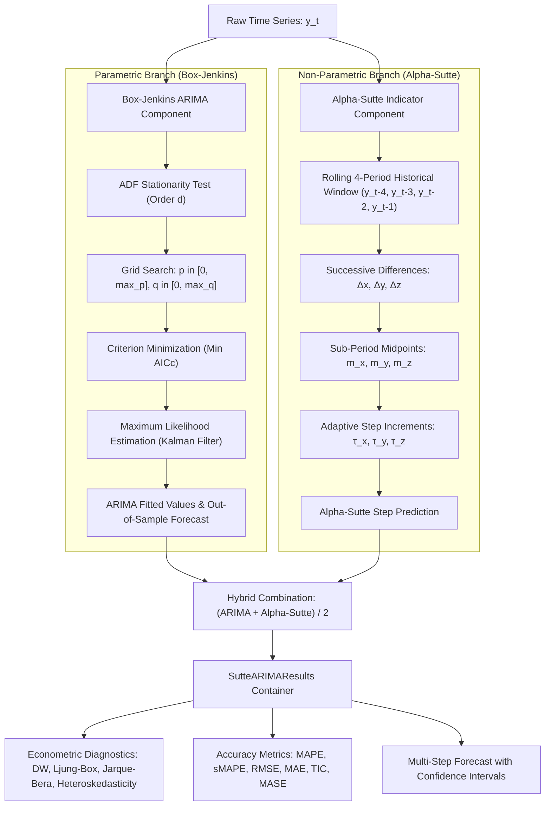

# Technical Documentation: SutteARIMA Model & Architecture

## 1. Executive Summary & Architectural Overview

**SutteARIMA** is an econometric time series forecasting package that hybridizes two distinct modeling paradigms:
1. **Parametric Box-Jenkins ARIMA / SARIMAX Model:** Captures linear autoregressive dependencies, non-stationary integration, and moving-average error shocks over historical data.
2. **Non-parametric α-Sutte Indicator (Ahmar, 2017):** Captures localized, non-linear momentum and short-term step increments without making rigid distributional assumptions.

By combining these two models into an equal-weighted ensemble, SutteARIMA mitigates individual model weaknesses: ARIMA's lag in responding to abrupt shifts is countered by the adaptive responsiveness of the α-Sutte indicator, while the α-Sutte indicator's sensitivity to transient noise is stabilized by ARIMA's parametric structure.



---

## 2. Mathematical Foundations

### 2.1 The α-Sutte Indicator (Ahmar, 2017)

The α-Sutte indicator is a non-parametric forecasting tool that computes rolling incremental changes using the four most recent data points $`(y_{t-4}, y_{t-3}, y_{t-2}, y_{t-1})`$:

1. **Successive Differences:**
   $`\Delta x = y_{t-3} - y_{t-4}, \quad \Delta y = y_{t-2} - y_{t-3}, \quad \Delta z = y_{t-1} - y_{t-2}`$

2. **Sub-period Midpoints:**
   $`m_x = \frac{y_{t-3} + y_{t-4}}{2}, \quad m_y = \frac{y_{t-2} + y_{t-3}}{2}, \quad m_z = \frac{y_{t-1} + y_{t-2}}{2}`$

3. **Dynamic Step Increments:**
   To guarantee numerical stability when midpoints approach zero, the step increments are computed as:
   $$\tau_x = \begin{cases} y_{t-3} \cdot \left(\frac{\Delta x}{m_x}\right), & \text{if } |m_x| > 10^{-12} \\ \Delta x, & \text{otherwise} \end{cases}$$

   $$\tau_y = \begin{cases} y_{t-2} \cdot \left(\frac{\Delta y}{m_y}\right), & \text{if } |m_y| > 10^{-12} \\ \Delta y, & \text{otherwise} \end{cases}$$

   $$\tau_z = \begin{cases} y_{t-1} \cdot \left(\frac{\Delta z}{m_z}\right), & \text{if } |m_z| > 10^{-12} \\ \Delta z, & \text{otherwise} \end{cases}$$

4. **Aggregate Change ($`\Delta_t`$) and Prediction:**
   $`\Delta_t = \frac{\tau_x + \tau_y + \tau_z}{3}, \quad \hat{Z}_t^{\alpha\text{-Sutte}} = y_{t-1} + \Delta_t`$

### 2.2 The Box-Jenkins ARIMA / SARIMAX Model

The univariate $\text{ARIMA}(p, d, q)$ process is formulated in backshift notation ($`B^k y_t = y_{t-k}`$) as:

$$\Phi_p(B) (1 - B)^d y_t = \Theta_q(B) \varepsilon_t$$

Where:
- $\Phi_p(B) = 1 - \phi_1 B - \phi_2 B^2 - \dots - \phi_p B^p$ is the Autoregressive (AR) lag polynomial.
- $(1 - B)^d$ is the difference operator of integration order $d$.
- $\Theta_q(B) = 1 + \theta_1 B + \theta_2 B^2 + \dots + \theta_q B^q$ is the Moving Average (MA) lag polynomial.
- $\varepsilon_t \overset{\text{iid}}{\sim} \mathcal{N}(0, \sigma^2)$ is Gaussian white noise.

When seasonal periodicity $s$ is specified, the multiplicative seasonal extension $\text{SARIMA}(p,d,q)\times(P,D,Q,s)$ is estimated:

$$\Phi_p(B)\tilde{\Phi}_P(B^s)(1 - B)^d(1 - B^s)^D y_t = \Theta_q(B)\tilde{\Theta}_Q(B^s)\varepsilon_t$$

### 2.3 Equal-Weighted Ensemble Combination

The final SutteARIMA prediction is the arithmetic mean of both model predictions:

$$\hat{Z}_t^{\text{SutteARIMA}} = \frac{\hat{Z}_t^{\text{ARIMA}} + \hat{Z}_t^{\alpha\text{-Sutte}}}{2}$$

> **Boundary Condition ($t < 4$):**
> Because the α-Sutte indicator requires four historical lags, the first four in-sample values $(t = 0, 1, 2, 3)$ rely directly on the ARIMA model fitted values. The composite hybrid formulation engages for all $t \ge 4$.

---

## 3. Codebase Architecture & Module Breakdown

The library is organized in a modular structure centered on `sutte_arima/model.py`:

```text
sutte-ARIMA/
├── sutte_arima/
│   ├── __init__.py       # Package entry-point exposing public API
│   └── model.py          # Core engine containing all classes and routines
├── pyproject.toml        # PEP 517/518 build specification
├── setup.py              # Backward-compatible setuptools installer
├── README.md             # Primary documentation and usage guide
└── DOCUMENTATION.md      # In-depth architectural documentation
```

### 3.1 Class & Function Structure in `model.py`

#### 1. `calculate_metrics(actual, predicted, train_data=None)`
Computes a comprehensive vector of 9 accuracy metrics between actual series and predicted series:
- **MAPE (%)**: Mean Absolute Percentage Error
- **sMAPE (%)**: Symmetric Mean Absolute Percentage Error (bounded in $[0\%, 200\%]$)
- **RMSE**: Root Mean Squared Error
- **MSE**: Mean Squared Error
- **MAE**: Mean Absolute Error
- **Theil's TIC**: Theil's Inequality Coefficient (normalized $[0, 1]$ scale)
- **MASE**: Mean Absolute Scaled Error (scaled against historical 1-step random walk differences)
- **MaxAE**: Maximum Absolute Error
- **MBE**: Mean Bias Error (detects systematic under- or over-forecasting)

#### 2. `class AlphaSutte`
Encapsulates all calculations for the α-Sutte indicator:
- `step_increment(y_t4, y_t3, y_t2, y_t1) -> float`: Evaluates sub-period midpoints and dynamic increments.
- `compute_fitted(series: np.ndarray) -> np.ndarray`: Computes in-sample rolling values for $t \ge 4$.
- `compute_forecast(series: np.ndarray, steps: int) -> np.ndarray`: Generates out-of-sample multi-step forecasts via recursive autoregressive roll-forward.

#### 3. `find_order(data, max_p=3, max_q=3, ic='AICc', verbose=False)`
Automated econometric order selection pipeline:
1. **Stationarity Identification:** Runs Augmented Dickey-Fuller (`adfuller`) tests. If the level series p-value is $< 0.05$, $d = 0$. Otherwise, it tests first differences to assign $d = 1$, falling back to $d = 2$ if needed.
2. **Grid Search:** Fits all candidate combinations of $p \in [0, \text{max\_p}]$ and $q \in [0, \text{max\_q}]$.
3. **Small-Sample Corrected Selection ($\text{AICc}$):** Selects the specification that minimizes Hurvich & Tsai's (1989) corrected criterion:
   $$\text{AICc} = \text{AIC} + \frac{2k(k+1)}{n - k - 1}$$

#### 4. `class SutteARIMAResults`
The fitted model results container (compliant with Statsmodels conventions):
- **Model Parameters:** Access to coefficients, standard errors (`bse`), z-scores, p-values, and confidence intervals (`params_table()`).
- **Information Criteria:** Direct properties for `.aic`, `.aicc`, `.bic`, `.hqic`, and `.llf`.
- **Econometric Diagnostics:**
  - `res.durbin_watson`: First-order residual serial correlation ($DW \approx 2.0$ indicates independence).
  - `res.ljung_box`: Portmanteau white-noise test for residual autocorrelation.
  - `res.jarque_bera`: Residual normality test evaluating skewness and kurtosis.
  - `res.heteroskedasticity`: Breakvar test evaluating residual variance constancy.
- **Forecasting & Intervals:** `.forecast(steps, alpha)` generates multi-step predictions with dynamic $(1 - \alpha) \times 100\%$ prediction bounds.
- **Visual Diagnostics:** `.plot(steps, alpha)` renders actual vs. fitted values and future forecast intervals.

#### 5. `class SutteARIMA`
Main entry point orchestrating model initialization and fitting:
- `__init__(endog, order='auto', seasonal_order=None)`: Validates observations ($n \ge 8$), triggers automatic order identification if requested, or validates user-supplied orders.
- `fit() -> SutteARIMAResults`: Fits the ARIMA component, executes α-Sutte calculations, ensembles predictions, and instantiates the results object.

---

## 4. Multi-Step Forecasting & Uncertainty Quantification

During an $h$-step out-of-sample forecast (`res.forecast(steps=h, alpha=0.05)`):

1. **ARIMA Component:** Employs Statsmodels' state-space Kalman filter to extract expected means $\hat{y}_{\text{ARIMA}, h}$ and analytical forecast standard errors $\text{SE}_{\text{ARIMA}, h}$.
2. **α-Sutte Component:** Generates recursive projections:
   $$\hat{y}_{\alpha, 1} = f(y_{T-3}, y_{T-2}, y_{T-1}, y_T)$$
   $$\hat{y}_{\alpha, 2} = f(y_{T-2}, y_{T-1}, y_T, \hat{y}_{\alpha, 1})$$
   $$\vdots$$
3. **Composite Point Forecast:**
   $$\hat{y}_{\text{hybrid}, h} = \frac{\hat{y}_{\text{ARIMA}, h} + \hat{y}_{\alpha, h}}{2}$$
4. **Hybrid Standard Error Scaling:**
   The hybrid residual standard deviation $\sigma_{\text{resid}}$ is scaled by the horizon expansion ratio of the ARIMA model:
   $$\text{SE}_{\text{hybrid}, h} = \sigma_{\text{resid}} \times \left(\frac{\text{SE}_{\text{ARIMA}, h}}{\text{SE}_{\text{ARIMA}, 1}}\right)$$
5. **Prediction Intervals:**
   Given significance level $\alpha$ (e.g., $\alpha = 0.05 \implies 95\%$ CI), the critical value $z = \Phi^{-1}(1 - \alpha/2)$ is calculated:
   $$\left[\hat{y}_{\text{hybrid}, h} - z \cdot \text{SE}_{\text{hybrid}, h}, \quad \hat{y}_{\text{hybrid}, h} + z \cdot \text{SE}_{\text{hybrid}, h}\right]$$

---

## 5. Summary Table of Econometric Diagnostics

| Test / Metric | Formula / Definition | Null Hypothesis ($H_0$) / Benchmark | Python API |
| :--- | :--- | :--- | :--- |
| **Durbin-Watson ($DW$)** | $`\frac{\sum_{t=2}^n (\hat{e}_t - \hat{e}_{t-1})^2}{\sum_{t=1}^n \hat{e}_t^2}`$ | $DW \approx 2.0 \implies$ No serial correlation | `res.durbin_watson` |
| **Ljung-Box ($Q$)** | $`n(n+2)\sum_{k=1}^m \frac{r_k^2}{n - k}`$ | $H_0\text{: Residuals are White Noise } (p > 0.05)$ | `res.ljung_box` |
| **Jarque-Bera ($JB$)** | $`\frac{n}{6}\left(S^2 + \frac{(K - 3)^2}{4}\right)`$ | $H_0\text{: Residuals are Normally Distributed } (p > 0.05)$ | `res.jarque_bera` |
| **Heteroskedasticity ($H$)** | Variance ratio across sub-samples | $H_0\text{: Residual variance is Homoskedastic } (p > 0.05)$ | `res.heteroskedasticity` |
| **AICc** | $`\text{AIC} + \frac{2k(k+1)}{n - k - 1}`$ | Lower is better (finite-sample corrected) | `res.aicc` |
| **MAPE (%)** | $`\frac{100\%}{n}\sum \left\lvert\frac{y_t - \hat{y}_t}{y_t}\right\rvert`$ | Benchmark relative forecast error | `res.mape` |
| **sMAPE (%)** | $`\frac{100\%}{n}\sum \frac{2\lvert y_t - \hat{y}_t\rvert}{\lvert y_t\rvert + \lvert\hat{y}_t\rvert}`$ | Symmetric error bounded between 0% and 200% | `res.smape` |
| **Theil's TIC** | $`\frac{\text{RMSE}}{\sqrt{\frac{1}{n}\sum y_t^2} + \sqrt{\frac{1}{n}\sum \hat{y}_t^2}}`$ | Normalized quality: $0 = \text{perfect}, 1 = \text{worst}$ | `res.tic` |
| **MASE** | $`\frac{\text{MAE}}{\frac{1}{n-1}\sum_{t=2}^n \lvert y_t - y_{t-1}\rvert}`$ | Scaled vs. random walk naive ($< 1 = \text{superior}$) | `res.mase` |

---

## 6. End-to-End Code Walkthrough

```python
import numpy as np
import statsmodels.api as sm
from sutte_arima import SutteARIMA, find_order

# 1. Load empirical dataset
data = sm.datasets.get_rdataset("AirPassengers", "datasets").data["value"].values[:132]

# 2. Automated fitting
model = SutteARIMA(data)   # Auto-detects (p, d, q) via ADF and AICc
res = model.fit()

# 3. Print estimation summary
print(res.summary())

# 4. Multi-step forecast (95% CI)
forecast_df = res.forecast(steps=6, alpha=0.05)
print(forecast_df)

# 5. Extract evaluation metrics table
print(res.metrics_table())
```
