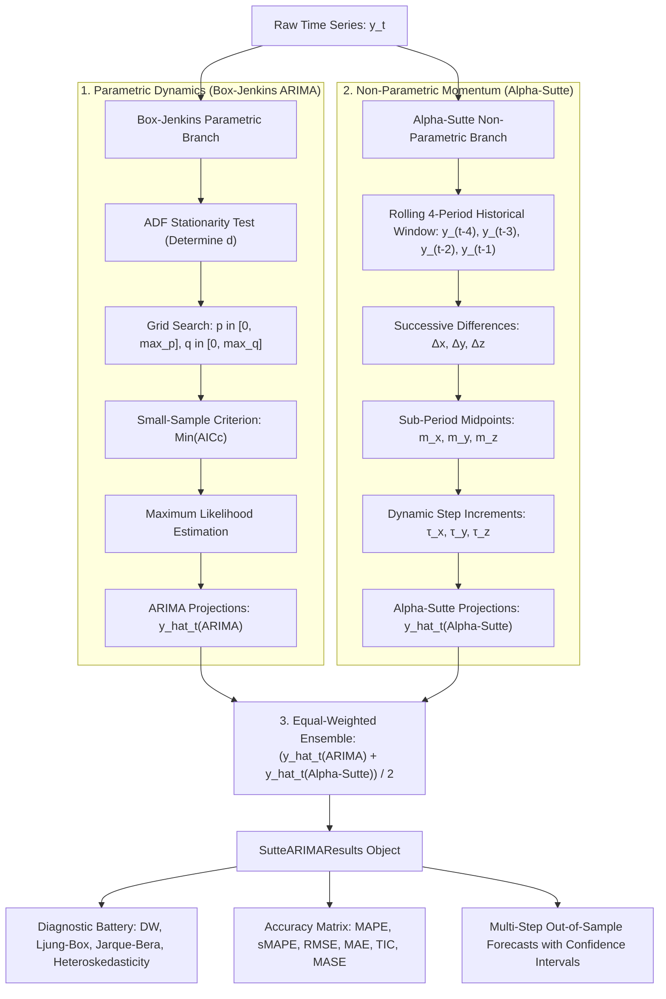
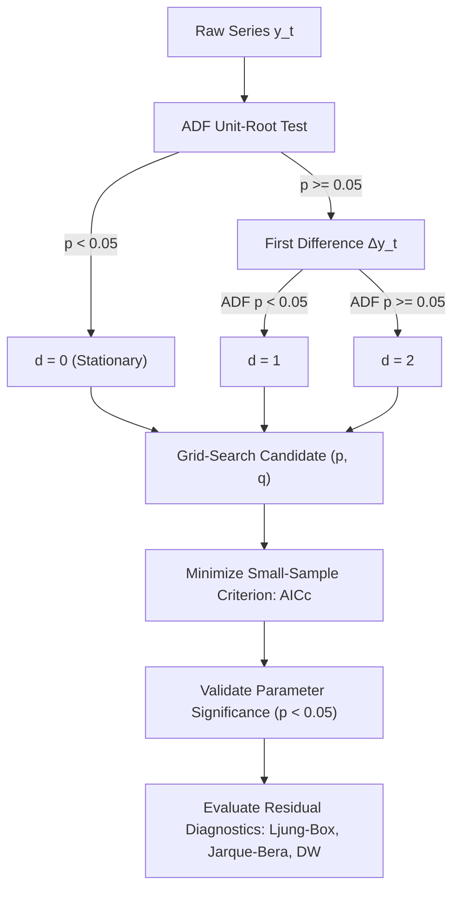

# SutteARIMA: Hybrid Time Series Forecasting for Econometrics

[](https://www.python.org/downloads/)
[](https://opensource.org/licenses/MIT)

**SutteARIMA** is an econometric time series forecasting library that combines the non-parametric **α-Sutte Indicator** (Ahmar, 2017) with the classical parametric **Box-Jenkins ARIMA/SARIMAX** model (Ahmar et al., 2019).

Designed with a clean, **statsmodels-compliant API** for econometricians, statisticians, and quantitative researchers—providing statistical rigor, automated order identification, comprehensive diagnostic test batteries, and multi-step forecasting with uncertainty intervals.

---

## Table of Contents

- [1. Mathematical Foundations & Theoretical Background](#1-mathematical-foundations--theoretical-background)
  - [1.1 The α-Sutte Indicator](#11-the-α-sutte-indicator)
  - [1.2 The Box-Jenkins ARIMA & SARIMAX Model](#12-the-box-jenkins-arima--sarimax-model)
  - [1.3 The Hybrid SutteARIMA Ensemble Formulation](#13-the-hybrid-suttearima-ensemble-formulation)
  - [1.4 Econometric Order Selection Methodology](#14-econometric-order-selection-methodology)
  - [1.5 Multi-Step Forecasting & Uncertainty Quantification](#15-multi-step-forecasting--uncertainty-quantification)
  - [1.6 Econometric Diagnostic Tests Battery](#16-econometric-diagnostic-tests-battery)
  - [1.7 Evaluation & Accuracy Metrics Reference](#17-evaluation--accuracy-metrics-reference)
- [2. Codebase Architecture & Software Documentation](#2-codebase-architecture--software-documentation)
  - [2.1 Architecture Overview & Directory Layout](#21-architecture-overview--directory-layout)
  - [2.2 Core Modules & API Reference](#22-core-modules--api-reference)
  - [2.3 Installation & System Requirements](#23-installation--system-requirements)
  - [2.4 Complete End-to-End Workflow](#24-complete-end-to-end-workflow)
  - [2.5 Formatted Estimation Summary Output](#25-formatted-estimation-summary-output)
- [3. Academic References](#3-academic-references)

---

# 1. Mathematical Foundations & Theoretical Background

Traditional ARIMA models rely entirely on linear lag polynomials and differencing, which can struggle to adapt quickly to localized non-linearities, short-run momentum, and sudden structural shifts. The **SutteARIMA** framework overcomes these limitations by combining parametric Box-Jenkins dynamics with the adaptive, non-parametric **α-Sutte** indicator.



---

### 1.1 The α-Sutte Indicator

Introduced by Dr. Ansari Saleh Ahmar (2017), the **α-Sutte indicator** is a non-parametric forecasting method that calculates dynamic relative changes across the four most recent chronological observations:

$$y_{t-4}, \quad y_{t-3}, \quad y_{t-2}, \quad y_{t-1}$$

The forecast for period $`t`$, denoted as $`\hat{y}_t^{\alpha\text{-Sutte}}`$, is derived through the following four steps:

#### Step 1: Successive Historical Differences ($`\Delta`$)

$$\Delta x = y_{t-3} - y_{t-4}, \quad \Delta y = y_{t-2} - y_{t-3}, \quad \Delta z = y_{t-1} - y_{t-2}$$

#### Step 2: Sub-Period Midpoints ($`m`$)

$$m_x = \frac{y_{t-3} + y_{t-4}}{2}, \quad m_y = \frac{y_{t-2} + y_{t-3}}{2}, \quad m_z = \frac{y_{t-1} + y_{t-2}}{2}$$

#### Step 3: Dynamic Step Increments ($`\tau`$) with Numerical Guard

To guarantee numerical stability when sub-period midpoints approach zero, each step increment applies a threshold guard ($`|m| > 10^{-12}`$):

$$\tau_x = \begin{cases} y_{t-3} \cdot \left(\frac{\Delta x}{m_x}\right) = \frac{2 \cdot y_{t-3}(y_{t-3} - y_{t-4})}{y_{t-3} + y_{t-4}}, & \text{if } |m_x| > 10^{-12} \\ \Delta x, & \text{otherwise} \end{cases}$$

$$\tau_y = \begin{cases} y_{t-2} \cdot \left(\frac{\Delta y}{m_y}\right) = \frac{2 \cdot y_{t-2}(y_{t-2} - y_{t-3})}{y_{t-2} + y_{t-3}}, & \text{if } |m_y| > 10^{-12} \\ \Delta y, & \text{otherwise} \end{cases}$$

$$\tau_z = \begin{cases} y_{t-1} \cdot \left(\frac{\Delta z}{m_z}\right) = \frac{2 \cdot y_{t-1}(y_{t-1} - y_{t-2})}{y_{t-1} + y_{t-2}}, & \text{if } |m_z| > 10^{-12} \\ \Delta z, & \text{otherwise} \end{cases}$$

#### Step 4: Aggregate Step Increment ($`\Delta_t`$) and Point Forecast

The overall step increment is the arithmetic average across all three dynamic sub-intervals:

$$\Delta_t = \frac{\tau_x + \tau_y + \tau_z}{3}$$

The resulting non-parametric projection for time $`t`$ is:

$$\hat{y}_t^{\alpha\text{-Sutte}} = y_{t-1} + \Delta_t$$

---

### 1.2 The Box-Jenkins ARIMA & SARIMAX Model

The univariate Box-Jenkins $`\text{ARIMA}(p, d, q)`$ process is formulated in backshift operator notation ($`B^k y_t = y_{t-k}`$) as:

$$\Phi_p(B) (1 - B)^d y_t = c + \Theta_q(B) \varepsilon_t$$

Where:
- $`\Phi_p(B) = 1 - \sum_{i=1}^p \phi_i B^i = 1 - \phi_1 B - \phi_2 B^2 - \dots - \phi_p B^p`$ is the Autoregressive (AR) lag polynomial of order $`p`$.
- $`(1 - B)^d`$ is the difference operator of integration order $`d`$, such that $`\Delta^d y_t = (1 - B)^d y_t`$.
- $`\Theta_q(B) = 1 + \sum_{j=1}^q \theta_j B^j = 1 + \theta_1 B + \theta_2 B^2 + \dots + \theta_q B^q`$ is the Moving Average (MA) lag polynomial of order $`q`$.
- $`c`$ is the constant or deterministic drift term.
- $`\varepsilon_t \overset{\text{i.i.d.}}{\sim} \mathcal{N}(0, \sigma^2)`$ is Gaussian white noise.

When seasonal periodicity $`s`$ is specified, the multiplicative seasonal extension $`\text{SARIMA}(p, d, q) \times (P, D, Q)_s`$ is defined as:

$$\Phi_p(B) \tilde{\Phi}_P(B^s) (1 - B)^d (1 - B^s)^D y_t = c + \Theta_q(B) \tilde{\Theta}_Q(B^s) \varepsilon_t$$

Where:
- $`\tilde{\Phi}_P(B^s) = 1 - \tilde{\phi}_1 B^s - \dots - \tilde{\phi}_P B^{P s}`$ is the seasonal AR polynomial.
- $`(1 - B^s)^D`$ is the seasonal differencing operator of order $`D`$.
- $`\tilde{\Theta}_Q(B^s) = 1 + \tilde{\theta}_1 B^s + \dots + \tilde{\theta}_Q B^{Q s}`$ is the seasonal MA polynomial.

---

### 1.3 The Hybrid SutteARIMA Ensemble Formulation

The hybrid SutteARIMA model combines the individual parametric and non-parametric predictions through an equal-weighted ensemble:

$$\hat{y}_t^{\text{SutteARIMA}} = \frac{\hat{y}_t^{\text{ARIMA}} + \hat{y}_t^{\alpha\text{-Sutte}}}{2}$$

#### Boundary Condition for In-Sample Fitting ($`t < 4`$):
Because the α-Sutte indicator strictly requires four lagged historical observations $`(y_{t-4}, y_{t-3}, y_{t-2}, y_{t-1})`$, α-Sutte step increments cannot be computed for in-sample indices $`t \in \{0, 1, 2, 3\}`$. The library applies the formal boundary condition:

$$\hat{y}_t^{\text{SutteARIMA}} = \begin{cases} \hat{y}_t^{\text{ARIMA}}, & \text{for } t < 4 \\ \frac{1}{2}\left(\hat{y}_t^{\text{ARIMA}} + \hat{y}_t^{\alpha\text{-Sutte}}\right), & \text{for } t \ge 4 \end{cases}$$

---

### 1.4 Econometric Order Selection Methodology

Finding the optimal lag specification $`(p, d, q)`$ follows the classical three-stage Box-Jenkins econometric methodology:



#### 1. Stationarity & Integration Order ($`d`$) via ADF Test
The Augmented Dickey-Fuller (ADF) regression is estimated:

$$\Delta y_t = \alpha + \beta t + \gamma y_{t-1} + \sum_{i=1}^k \delta_i \Delta y_{t-i} + e_t$$

Testing the unit-root hypotheses:

$$H_0: \gamma = 0 \quad (\text{Unit Root Present, Non-Stationary}) \quad \text{vs.} \quad H_1: \gamma < 0 \quad (\text{Stationary})$$

- If the level series p-value satisfies $`p_{\text{ADF}} < 0.05`$, the series is integrated of order zero $`I(0) \implies d = 0`$.
- If $`p_{\text{ADF}} \ge 0.05`$, the series is differenced $`\Delta y_t = y_t - y_{t-1}`$. If $`p_{\text{ADF}}(\Delta y_t) < 0.05 \implies d = 1`$.
- If still non-stationary, second differencing $`\Delta^2 y_t`$ is evaluated $`\implies d = 2`$.

#### 2. Candidate Order Space ($`p, q`$) & Maximum Likelihood Estimation
Candidate combinations of $`p \in [0, p_{\max}]`$ and $`q \in [0, q_{\max}]`$ are fitted using Maximum Likelihood Estimation (via the Kalman filter):

$$\ln \hat{L} = -\frac{n}{2}\ln(2\pi) - \frac{n}{2}\ln(\sigma^2) - \frac{1}{2\sigma^2}\sum_{t=1}^n \varepsilon_t^2$$

#### 3. Information Criteria Selection & Finite-Sample Correction
To balance goodness-of-fit against overparameterization:
- **Akaike Information Criterion (AIC):**
  $$\text{AIC} = -2\ln \hat{L} + 2k$$
  where $`k = p + q + 1`$ is the number of estimated parameters.
- **Hurvich & Tsai's Corrected Criterion (AICc) (Default):**
  $$\text{AICc} = \text{AIC} + \frac{2k(k+1)}{n - k - 1}$$
  In finite samples ($`n < 200`$), standard AIC penalizes extra parameters too weakly, leading to overfitting. $\text{AICc}$ provides exact small-sample correction.
- **Bayesian Information Criterion (BIC / Schwarz):**
  $$\text{BIC} = -2\ln \hat{L} + k\ln(n)$$

#### 4. Principle of Parsimony & Residual Diagnostics
Estimated coefficients are tested for individual significance ($`p < 0.05`$), and residuals must satisfy white noise and normality assumptions.

---

### 1.5 Multi-Step Forecasting & Uncertainty Quantification

For an $`h`$-step ahead forecast horizon ($`h = 1, 2, \dots, H`$):

#### 1. Point Forecast Synthesis
- **ARIMA Component:** Uses state-space Kalman filtering to compute conditional expectations and analytical standard errors:
  $$\hat{y}_{T+h}^{\text{ARIMA}} = \mathbb{E}\left[y_{T+h} \mid \mathcal{F}_T\right]$$
- **α-Sutte Component:** Recursively projects forward by rolling the four-point evaluation window:
  $$\hat{y}_{T+1}^{\alpha} = y_T + \Delta(y_{T-3}, y_{T-2}, y_{T-1}, y_T)$$
  $$\hat{y}_{T+2}^{\alpha} = \hat{y}_{T+1}^{\alpha} + \Delta(y_{T-2}, y_{T-1}, y_T, \hat{y}_{T+1}^{\alpha})$$
  $$\hat{y}_{T+h}^{\alpha} = \hat{y}_{T+h-1}^{\alpha} + \Delta(\hat{y}_{T+h-4}^{\alpha}, \hat{y}_{T+h-3}^{\alpha}, \hat{y}_{T+h-2}^{\alpha}, \hat{y}_{T+h-1}^{\alpha})$$
- **Hybrid Point Forecast:**
  $$\hat{y}_{T+h}^{\text{hybrid}} = \frac{\hat{y}_{T+h}^{\text{ARIMA}} + \hat{y}_{T+h}^{\alpha}}{2}$$

#### 2. Hybrid Standard Error Scaling
The hybrid residual standard deviation $`\sigma_{\text{resid}} = \sqrt{\frac{1}{n}\sum_{t=1}^n (y_t - \hat{y}_t)^2}`$ is scaled by the horizon expansion ratio of the ARIMA model:

$$\text{SE}_{T+h}^{\text{hybrid}} = \sigma_{\text{resid}} \times \left(\frac{\text{SE}_{T+h}^{\text{ARIMA}}}{\text{SE}_{T+1}^{\text{ARIMA}}}\right)$$

#### 3. $(1 - \alpha_{\text{ci}})\times 100\%$ Prediction Intervals
For a significance level $`\alpha_{\text{ci}}`$ (e.g., $`\alpha_{\text{ci}} = 0.05 \implies 95\%`$ confidence interval), the critical value $`z = \Phi^{-1}(1 - \alpha_{\text{ci}}/2)`$ is derived from the standard normal quantile function ($`z \approx 1.960`$ for 95%):

$$\left[\hat{y}_{T+h}^{\text{hybrid}} - z \cdot \text{SE}_{T+h}^{\text{hybrid}}, \quad \hat{y}_{T+h}^{\text{hybrid}} + z \cdot \text{SE}_{T+h}^{\text{hybrid}}\right]$$

---

### 1.6 Econometric Diagnostic Tests Battery

Residual diagnostic checks verify that model residuals $`\hat{e}_t = y_t - \hat{y}_t`$ behave as classical Gaussian white noise:

| Diagnostic Test | Mathematical Formula | Null Hypothesis ($`H_0`$) & Target | Python Call |
| :--- | :--- | :--- | :--- |
| **Durbin-Watson ($`DW`$)** | $`\frac{\sum_{t=2}^n (\hat{e}_t - \hat{e}_{t-1})^2}{\sum_{t=1}^n \hat{e}_t^2}`$ | $`DW \approx 2.0 \implies \text{No first-order serial correlation}`$ | `res.durbin_watson` |
| **Ljung-Box ($`Q`$)** | $`n(n+2)\sum_{k=1}^m \frac{r_k^2}{n - k}`$ | $`H_0\text{: Residuals are White Noise } (p > 0.05)`$ | `res.ljung_box` |
| **Jarque-Bera ($`JB`$)** | $`\frac{n}{6}\left(S^2 + \frac{(K - 3)^2}{4}\right)`$ | $`H_0\text{: Residuals are Normally Distributed } (p > 0.05)`$ | `res.jarque_bera` |
| **Heteroskedasticity ($`H`$)** | $`\frac{\sum_{t=n-h+1}^n \hat{e}_t^2}{\sum_{t=1}^h \hat{e}_t^2}`$ | $`H_0\text{: Residual variance is Homoskedastic } (p > 0.05)`$ | `res.heteroskedasticity` |

---

### 1.7 Evaluation & Accuracy Metrics Reference

All forecasting performance metrics are computed from actual observations $`y_t`$ and corresponding model predictions $`\hat{y}_t`$ across $`t = 1, \dots, n`$:

| Metric | Mathematical Formula | Description & Benchmark | Python Call |
| :--- | :--- | :--- | :--- |
| **MAPE (%)** | $`\frac{100\%}{n}\sum_{t=1}^n \left\lvert\frac{y_t - \hat{y}_t}{y_t}\right\rvert`$ | Mean Absolute Percentage Error (standard in Sutte literature) | `res.mape` |
| **sMAPE (%)** | $`\frac{100\%}{n}\sum_{t=1}^n \frac{2\lvert y_t - \hat{y}_t\rvert}{\lvert y_t\rvert + \lvert\hat{y}_t\rvert}`$ | Symmetric MAPE; bounded strictly in $[0\%, 200\%]$ | `res.smape` |
| **RMSE** | $`\sqrt{\frac{1}{n}\sum_{t=1}^n (y_t - \hat{y}_t)^2}`$ | Root Mean Squared Error (penalizes large outlier errors) | `res.rmse` |
| **MSE** | $`\frac{1}{n}\sum_{t=1}^n (y_t - \hat{y}_t)^2`$ | Mean Squared Error (prediction variance) | `res.mse` |
| **MAE** | $`\frac{1}{n}\sum_{t=1}^n \lvert y_t - \hat{y}_t\rvert`$ | Mean Absolute Error (robust linear distance) | `res.mae` |
| **Theil's TIC** | $`\frac{\text{RMSE}}{\sqrt{\frac{1}{n}\sum_{t=1}^n y_t^2} + \sqrt{\frac{1}{n}\sum_{t=1}^n \hat{y}_t^2}}`$ | Theil's Inequality Coefficient ($`0 = \text{perfect}`$, $`1 = \text{worst}`$) | `res.tic` |
| **MASE** | $`\frac{\text{MAE}}{\frac{1}{N_{\text{train}}-1}\sum_{t=2}^{N_{\text{train}}} \lvert y_t - y_{t-1}\rvert}`$ | Scaled vs. random walk naive benchmark ($`< 1 = \text{superior}`$) | `res.mase` |
| **MaxAE** | $`\max_{1 \le t \le n} \lvert y_t - \hat{y}_t\rvert`$ | Maximum Absolute Error (worst-case individual prediction error) | `res.max_ae` |
| **MBE** | $`\frac{1}{n}\sum_{t=1}^n (y_t - \hat{y}_t)`$ | Mean Bias Error (positive = under-forecast, negative = over-forecast) | `res.mbe` |

---

# 2. Codebase Architecture & Software Documentation

### 2.1 Architecture Overview & Directory Layout

The codebase is organized with a clean, functional separation of concerns:

```text
sutte-ARIMA/
├── sutte_arima/
│   ├── __init__.py       # Package public interface (exposes classes and functions)
│   └── model.py          # Complete modeling engine, diagnostics, and algorithms
├── pyproject.toml        # Modern build tool configuration (PEP 517/518)
├── setup.py              # Setuptools distribution script
└── README.md             # Consolidated documentation and user guide
```

---

### 2.2 Core Modules & API Reference

#### 1. Metric Calculation Engine: `calculate_metrics()`
```python
calculate_metrics(actual: Sequence[float], predicted: Sequence[float], train_data: Optional[Sequence[float]] = None) -> Dict[str, float]
```
- Filters out NaN/Inf pairs dynamically.
- Calculates all 9 accuracy metrics and returns a formatted dictionary.
- If `train_data` is supplied, computes MASE normalized by in-sample 1-step naive differences.

#### 2. α-Sutte Component: `class AlphaSutte`
- `step_increment(y_t4: float, y_t3: float, y_t2: float, y_t1: float) -> float`: Evaluates midpoints and dynamic increments.
- `compute_fitted(series: np.ndarray) -> np.ndarray`: Computes in-sample rolling values for $`t \ge 4`$.
- `compute_forecast(series: np.ndarray, steps: int) -> np.ndarray`: Produces out-of-sample recursive forecasts.

#### 3. Automatic Order Search: `find_order()`
```python
find_order(data: Sequence[float], max_p: int = 3, max_q: int = 3, ic: str = "AICc", verbose: bool = False) -> Tuple[int, int, int]
```
- Performs ADF unit-root tests to determine integration order $`d \in \{0, 1, 2\}`$.
- Grid-searches all candidate combinations of $`p \in [0, \text{max\_p}]`$ and $`q \in [0, \text{max\_q}]`$.
- Minimizes the designated information criterion (`"AICc"`, `"AIC"`, `"BIC"`, or `"HQIC"`).

#### 4. Model Estimation & Fitting: `class SutteARIMA`
```python
model = SutteARIMA(endog: Sequence[float], order: Union[str, Tuple[int, int, int]] = "auto", seasonal_order: Optional[Tuple[int, int, int, int]] = None)
res = model.fit()
```
- Validates sample size ($`n \ge 8`$).
- Supports explicit `order=(p, d, q)` or automated order selection `order="auto"`.
- Supports seasonal specifications `seasonal_order=(P, D, Q, s)`.
- Returns an instantiated `SutteARIMAResults` object.

#### 5. Estimation Results Container: `class SutteARIMAResults`
- **Parameters & Inference:** `.params`, `.bse`, `.pvalues`, `.params_table()`
- **Information Criteria:** `.aic`, `.aicc`, `.bic`, `.hqic`, `.llf`
- **Residual Diagnostics:** `.durbin_watson`, `.ljung_box`, `.jarque_bera`, `.heteroskedasticity`
- **Forecasting:** `.forecast(steps=1, alpha=0.05) -> pd.DataFrame` (returns `hybrid_forecast`, `se`, `ci_lower`, `ci_upper`)
- **Accuracy Tables:** `.metrics_table(test_data=None) -> pd.DataFrame`
- **Summary:** `.summary() -> str` (produces statsmodels-style ASCII regression summary)
- **Visualization:** `.plot(steps=None, alpha=0.05, figsize=(10, 5))`

---

### 2.3 Installation & System Requirements

Install directly from GitHub via `pip`:

```bash
pip install --upgrade git+https://github.com/BahmanOrujov/sutte-ARIMA.git
```

#### Core Dependencies:
- `numpy >= 1.20`
- `pandas >= 1.2`
- `scipy >= 1.6`
- `statsmodels >= 0.12`
- `matplotlib` *(optional, for visualization)*

---

### 2.4 Complete End-to-End Workflow

```python
import statsmodels.api as sm
from sutte_arima import SutteARIMA, find_order

# 1. Load empirical dataset (e.g. Airline Passenger numbers)
data = sm.datasets.get_rdataset("AirPassengers", "datasets").data["value"].values[:132]

# ---------------------------------------------------------
# Option A: Automatic Order Selection (Just 2 lines of code!)
# ---------------------------------------------------------
model = SutteARIMA(data)  # order='auto' by default (ADF test + AICc minimization)
res = model.fit()

# View full econometric summary table
print(res.summary())

# ---------------------------------------------------------
# Option B: Explicit Econometric Order Specification
# ---------------------------------------------------------
model_manual = SutteARIMA(data, order=(0, 1, 1))
res_manual = model_manual.fit()

# ---------------------------------------------------------
# Multi-Step Out-of-Sample Forecasting (with 95% Confidence Intervals)
# ---------------------------------------------------------
forecast_df = res_manual.forecast(steps=6, alpha=0.05)
print(forecast_df)

# ---------------------------------------------------------
# Visual Diagnostics (Actual vs. Fitted vs. 12-Step Forecast)
# ---------------------------------------------------------
res_manual.plot(steps=12)
```

---

### 2.5 Formatted Estimation Summary Output

Calling `print(res.summary())` generates a comprehensive econometrics summary:

```text
========================================================================
                  SutteARIMA Model Estimation Results                   
========================================================================
 Dep. Variable       : y                      No. Observations : 132
 Model               : SutteARIMA(0, 1, 1)    Log-Likelihood   : -629.598  
 AIC                 : 1263.195               AICc             : 1263.288  
 BIC                 : 1268.945               HQIC             : 1265.532  
------------------------------------------------------------------------
              Model Accuracy Matrix (MAPE, MSE, RMSE, MAE)              
------------------------------------------------------------------------
 MAPE (%)            : 9.3010 %               sMAPE (%)        : 9.3832 %
 MSE                 : 1099.6808              RMSE             : 33.1614   
 MAE                 : 25.1785                Theil's IC (TIC) : 0.0577    
 Max Error (MaxAE)   : 126.6663               Mean Bias (MBE)  : 0.0318    
------------------------------------------------------------------------
                         ARIMA Parameter Estimates                        
------------------------------------------------------------------------
              coef   std err         z     P>|z|     [0.025     0.975]
 ma.L1      0.3730    0.0886    4.2082    0.0000     0.1993     0.5468
 sigma2   873.9665   94.2428    9.2736    0.0000   689.2540  1058.6791
------------------------------------------------------------------------
                         Residual Diagnostic Tests                        
------------------------------------------------------------------------
 Durbin-Watson       : 1.6834        (autocorrelation: ~2.0 is ideal)
 Ljung-Box (Q)       : 56.4081       Prob(Q)          : 0.0000 (white noise)
 Jarque-Bera (JB)    : 21.7344       Prob(JB)         : 0.0000 (normality)
 Heteroskedasticity  : 7.2562        Prob(H)          : 0.0000 (homoskedasticity)
 Skew                : -0.4515       Kurtosis         : 4.8055    
========================================================================
```

---

# 3. Academic References

1. **Ahmar, A. S.** (2017). "A Comparison of the α-Sutte Indicator and Moving Average (MA) Method in Forecasting Stock Prices." *International Journal of Advanced Science and Technology*, 103, 41–48.
2. **Ahmar, A. S., Rahman, A., & Mulbar, U.** (2018). "α-Sutte Indicator: a new method for time series forecasting." *Journal of Physics: Conference Series*, 1040, 012018.
3. **Ahmar, A. S., et al.** (2019). "SutteARIMA: Short-Term Forecasting Method." *Journal of Physics: Conference Series*, 1364, 012028.
4. **Box, G. E., Jenkins, G. M., Reinsel, G. C., & Ljung, G. M.** (2015). *Time Series Analysis: Forecasting and Control*. 5th Edition, John Wiley & Sons.
5. **Hurvich, C. M., & Tsai, C.-L.** (1989). "Regression and time series model selection in small samples." *Biometrika*, 76(2), 297–307.
