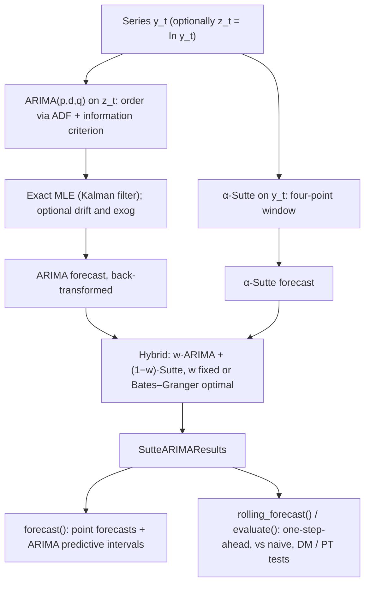

# SutteARIMA: Hybrid α-Sutte + ARIMA Forecasting for Econometrics

[](https://www.python.org/downloads/)
[](https://opensource.org/licenses/MIT)
[](CHANGELOG.md)

**SutteARIMA** combines the non-parametric **α-Sutte indicator** (Ahmar, 2017) with the parametric **Box-Jenkins ARIMA/SARIMAX** model (Ahmar et al., 2019) behind a **statsmodels-style API**: automatic order selection, residual diagnostics, multi-step forecasts with prediction intervals and, since version 2.0, leakage-free out-of-sample evaluation against the naive benchmark.

---

## What is new in 2.0

Version 2.0 keeps the original estimator as the default (equal-weight average of an ARIMA forecast and the α-Sutte forecast on the original scale; point forecasts are identical to 1.0) and adds what is needed to use it in a statistically sound way.

| Area | 1.0 | 2.0 |
|---|---|---|
| Scale | levels only | `transform="log"` for multiplicative / heteroskedastic series (prices) |
| Trend | statsmodels silently drops the constant when `d > 0` | `trend="drift"` (constant in the `d`-th difference) or any statsmodels trend |
| Exogenous regressors | not supported | `exog=` (regression with ARIMA errors), semantics and look-ahead rule documented |
| Combination weight | fixed 0.5 | `weight=` any value in [0, 1] or `"optimal"` (Bates & Granger, 1969) |
| Out-of-sample evaluation | static multi-step only, no benchmark | `rolling_forecast()` (expanding window, no look-ahead, `refit_every`) and `evaluate()` (U2, Diebold-Mariano, Pesaran-Timmermann) |
| Prediction intervals | hybrid-centred heuristic | quantiles of the ARIMA predictive distribution (`interval="arima"`); the old rule is available as `interval="legacy"` |
| Comparison tests | — | `diebold_mariano()`, `pesaran_timmermann()`, `theil_u2()`, `U2` in `calculate_metrics()` |
| Order selection | AICc computed by hand with `k = p + q + 1`; lower-case `ic` crashed | statsmodels AICc/BIC/HQIC; case-insensitive `ic`; `transform`, `trend`, `exog`, fixed `d` |
| Diagnostics | DW, Ljung-Box, Jarque-Bera, break-variance | + ARCH-LM; tests on the modelling scale |
| Side effects | `warnings.filterwarnings("ignore")` at import (global) | warnings are filtered locally during estimation only |
| Tests | — | `tests/` (pytest): equivalence with the reference R implementation, backward compatibility, no look-ahead, exog rules, test statistics |

See [CHANGELOG.md](CHANGELOG.md) for details and migration notes.

---

## Table of Contents

1. [Mathematical foundations](#1-mathematical-foundations)
2. [Statistical properties of α-Sutte (read before using it)](#2-statistical-properties-of-α-sutte)
3. [Evaluation methodology](#3-evaluation-methodology)
4. [API reference](#4-api-reference)
5. [End-to-end workflow](#5-end-to-end-workflow)
6. [References](#6-references)

---

# 1. Mathematical foundations



### 1.1 The α-Sutte indicator

For the four most recent observations $`y_{t-4},\dots,y_{t-1}`$:

$$\Delta x = y_{t-3}-y_{t-4},\quad \Delta y = y_{t-2}-y_{t-3},\quad \Delta z = y_{t-1}-y_{t-2}$$

$$m_x = \frac{y_{t-3}+y_{t-4}}{2},\quad m_y = \frac{y_{t-2}+y_{t-3}}{2},\quad m_z = \frac{y_{t-1}+y_{t-2}}{2}$$

$$\tau_x = y_{t-3}\frac{\Delta x}{m_x},\quad \tau_y = y_{t-2}\frac{\Delta y}{m_y},\quad \tau_z = y_{t-1}\frac{\Delta z}{m_z},\qquad \delta_t = \frac{\tau_x+\tau_y+\tau_z}{3}$$

$$\hat{y}_{t}^{\text{Sutte}} = y_{t-1} + \delta_t$$

A guard replaces $`\tau = \Delta`$ when $`|m| < 10^{-12}`$. The implementation reproduces the reference R implementation `alpha.sutte` of the CRAN package `sutteForecastR` 0.1 (Ahmar, 2017) to machine precision (see `tests/`). Multi-step forecasts are recursive: forecasts are fed back into the four-point window.

### 1.2 The ARIMA component

$$\Phi_p(B)\,\tilde\Phi_P(B^s)\,(1-B)^d(1-B^s)^D z_t = c_t + \Theta_q(B)\,\tilde\Theta_Q(B^s)\,\varepsilon_t,\qquad \varepsilon_t \sim \text{WN}(0,\sigma^2)$$

with $`z_t = y_t`$ (default) or $`z_t = \ln y_t`$ (`transform="log"`). Parameters are estimated by exact maximum likelihood through the Kalman filter (statsmodels).

**Trend.** statsmodels writes the trend in levels, $`z_t = \text{trend}_t + u_t`$ with $`u_t`$ integrated, so a constant is not identified when $`d+D>0`$. `trend="drift"` adds the trend term of power $`d+D`$, i.e. a constant in the differenced series ($`\Delta z_t = c + \dots`$ for $`d=1`$).

**Exogenous regressors (regression with ARIMA errors).**

$$z_t = x_t'\beta + u_t,\qquad u_t \sim \text{ARIMA}(p,d,q)\quad\Longrightarrow\quad \Delta z_t = \Delta x_t'\beta + \text{ARMA error}\ \ (d=1)$$

Consequences for intervention dummies when $`d = 1`$ (Box & Tiao, 1975):

| `exog` column | Effect on $`\Delta z_t`$ | Effect on the level of $`z_t`$ |
|---|---|---|
| pulse $`\mathbb 1\{t=t_0\}`$ | $`+\beta`$ at $`t_0`$, $`-\beta`$ at $`t_0+1`$ | one-period jump that fully reverts |
| step $`\mathbb 1\{t\ge t_0\}`$ | $`+\beta`$ at $`t_0`$ | permanent level shift |
| window $`\mathbb 1\{t_0\le t\le t_1\}`$ | $`+\beta`$ at entry, $`-\beta`$ at exit | shift that **fully reverts when the window ends** |
| ramp $`\sum_{s\le t}\mathbb 1\{t_0\le s\le t_1\}`$ | $`+\beta`$ on every window day | permanent cumulative effect $`\beta L`$ |

To estimate the effect of an event on **returns** (growth rates) during a window with `transform="log"` and `d=1`, pass the cumulative sum of the window dummy.

> **Look-ahead rule.** Every regressor must be known when the forecast is made. Never build exog from the contemporaneous value of the series (e.g. a dummy for "today's return exceeds 8%"): the regressor then contains the dependent variable, produces spectacular but meaningless t-statistics and information criteria, and cannot be used for forecasting.

### 1.3 The hybrid

$$\hat{y}_t^{\text{SutteARIMA}} = w\,\hat{y}_t^{\text{ARIMA}} + (1-w)\,\hat{y}_t^{\text{Sutte}},\qquad w\in[0,1]$$

$`w = 0.5`$ is the original SutteARIMA. With `weight="optimal"` the weight minimises the in-sample sum of squared one-step errors of the combination (Bates & Granger, 1969):

$$w^* = \frac{\sum_t e^S_t\,(e^S_t-e^A_t)}{\sum_t (e^A_t-e^S_t)^2},\quad\text{clipped to } [0,1]$$

where $`e^A_t = y_t-\hat y^{\text{ARIMA}}_t`$ and $`e^S_t = y_t-\hat y^{\text{Sutte}}_t`$; relative errors $`e_t/y_t`$ are used when `transform="log"`. For $`t < 4`$ (no α-Sutte value) the hybrid equals the ARIMA fit; the first $`d + Ds`$ ARIMA fitted values come from the diffuse initialisation and are reported as `NaN`.

### 1.4 Order selection (`find_order`)

1. **Integration order** from ADF tests on $`z_t`$: $`d=0`$ if the level is stationary at 5%, else $`d=1`$ if the first difference is, else $`d=2`$ (or supply `d=`).
2. **Grid search** over $`p\le p_{\max}`$, $`q\le q_{\max}`$ with the same `trend` and `exog` as the final model.
3. **Criterion**: AICc (default), AIC, BIC or HQIC from statsmodels, where $`k`$ counts all estimated parameters including $`\sigma^2`$:

$$\text{AIC}=-2\ln\hat L+2k,\qquad \text{AICc}=\text{AIC}+\frac{2k(k+1)}{n-k-1},\qquad \text{BIC}=-2\ln\hat L+k\ln n$$

AICc is a finite-sample correction (Hurvich & Tsai, 1989); BIC is consistent and usually preferable for long series.

### 1.5 Forecasts and prediction intervals

* **Point forecasts**: $`\hat y_{T+h} = w\,\hat y^{\text{ARIMA}}_{T+h} + (1-w)\,\hat y^{\text{Sutte}}_{T+h}`$. With `transform="log"`, $`\hat y^{\text{ARIMA}}_{T+h} = \exp(\hat z_{T+h})`$ is the predictive **median**.
* **Intervals (`interval="arima"`, default)**: quantiles of the predictive distribution of the fitted ARIMA model, back-transformed when `transform="log"`. A prediction interval describes the distribution of the future observation, so it does not depend on which point forecast is reported.
* **`interval="legacy"`**: the 1.0 rule (hybrid-centred; in-sample hybrid residual SD scaled by the ARIMA standard-error growth). It has no probabilistic justification and badly understates uncertainty at long horizons for the recursive α-Sutte (see §2); it is kept only to reproduce 1.0 results.

### 1.6 Residual diagnostics (`summary()`)

| Test | Statistic | $`H_0`$ |
|---|---|---|
| Durbin-Watson | $`\sum(\hat e_t-\hat e_{t-1})^2/\sum\hat e_t^2`$ | no first-order autocorrelation (≈ 2) |
| Ljung-Box | $`n(n+2)\sum_{k=1}^m r_k^2/(n-k)`$ | no autocorrelation |
| ARCH-LM (Engle, 1982) | $`nR^2`$ of $`\hat e_t^2`$ on its lags | no conditional heteroskedasticity |
| Jarque-Bera | $`\frac n6\big(S^2+\frac{(K-3)^2}{4}\big)`$ | normality |
| Break-variance | ratio of residual variances in the last/first thirds | homoskedasticity |

Hybrid residuals are tested on the modelling scale ($`\ln y_t - \ln\hat y_t`$ when `transform="log"`).

---

# 2. Statistical properties of α-Sutte

Because $`y_{t-j}/m_{t-j} = 1/(1-g_{t-j}/2)`$ with $`g_{t-j} = \Delta y_{t-j}/y_{t-j}`$,

$$\delta_t \;=\; \underbrace{\tfrac13\sum_{j=1}^{3}\Delta y_{t-j}}_{\text{average of the last three changes}} \;+\; \underbrace{\tfrac16\sum_{j=1}^{3}y_{t-j}\,g_{t-j}^2}_{\approx\, y\,\sigma^2/2\ \text{(upward bias)}} \;+\; O(g^3).$$

α-Sutte is therefore a short-run **momentum extrapolation**. Consequences when the series is close to a random walk, $`\Delta y_t = \varepsilon_t`$ with variance $`\sigma^2`$ (the usual case for asset prices):

| Property | Result |
|---|---|
| One-step error | $`e_t \approx \varepsilon_t - \tfrac13(\varepsilon_{t-1}+\varepsilon_{t-2}+\varepsilon_{t-3})`$, $`\operatorname{Var} = \tfrac43\sigma^2`$, so $`\text{RMSE}_{\text{Sutte}}/\text{RMSE}_{\text{naive}} \approx \sqrt{4/3} = 1.155`$ |
| Equal-weight hybrid with a random-walk-like ARIMA | error variance $`(1+\tfrac1{12})\sigma^2`$, ratio ≈ 1.04 |
| Optimal combination weight | $`w^* = \dfrac{\sigma_S^2-\sigma_{AS}}{\sigma_A^2+\sigma_S^2-2\sigma_{AS}} = \dfrac{4/3-1}{1+4/3-2} = 1`$: α-Sutte gets **zero** weight |
| Recursive $`h`$-step forecast | increments converge to $`(3\Delta y_T+2\Delta y_{T-1}+\Delta y_{T-2})/6`$, i.e. a linear trend; error variance ≈ $`h\sigma^2 + 0.39\,h^2\sigma^2`$ versus $`h\sigma^2`$ for the naive forecast |

α-Sutte can only add value when changes are positively autocorrelated. **Always compare against the naive forecast** with `evaluate()`; level-scale MAPE values of 1–2% for daily prices mainly reflect persistence, not forecasting skill.

**A note on the literature.** The reference function `sutteForecastR::alpha.sutte` reports α-Sutte "test" forecasts that are one-step-ahead predictions using the realised test observations, while the competing models (auto.arima, Holt-Winters, NNETAR, robust ETS, theta) are evaluated with 1- to 7-step static forecasts from the end of the training sample. Comparisons made this way favour α-Sutte mechanically. `rolling_forecast()` evaluates all components under the same one-step-ahead information set.

---

# 3. Evaluation methodology

* **`rolling_forecast(test, exog=None, refit_every=None)`**: expanding-window one-step-ahead forecasts. The forecast of observation $`t`$ uses only data up to $`t-1`$ (plus the period-$`t`$ value of `exog`, which must be known in advance). With `refit_every=k` the ARIMA (and an `"optimal"` weight) is re-estimated every $`k`$ observations; between refits the Kalman filter is run with fixed parameters.
* **`evaluate(...)`**: metrics for the hybrid, its two components and the naive forecast $`\hat y_t = y_{t-1}`$, plus
  * **Theil's U2** $`=\text{RMSE}/\text{RMSE}_{\text{naive}}`$ (< 1 beats the naive forecast);
  * **Diebold-Mariano** test with the Harvey-Leybourne-Newbold correction (squared and absolute loss) against the naive forecast;
  * **Pesaran-Timmermann** test of directional accuracy.
* **`metrics(test)`**: static multi-step accuracy from the end of the sample (U2 against the naive multi-step forecast).

| Metric | Formula | Note |
|---|---|---|
| MAPE (%) | $`\frac{100}{n}\sum\lvert(y_t-\hat y_t)/y_t\rvert`$ | |
| sMAPE (%) | $`\frac{100}{n}\sum\frac{2\lvert y_t-\hat y_t\rvert}{\lvert y_t\rvert+\lvert\hat y_t\rvert}`$ | |
| RMSE, MSE, MAE, MaxAE, MBE | standard | MBE = mean(actual − predicted) |
| TIC (Theil U1) | $`\frac{\text{RMSE}}{\sqrt{\overline{y^2}}+\sqrt{\overline{\hat y^2}}}`$ | close to 0 for any level forecast of a persistent series — not a skill measure |
| U2 | $`\text{RMSE}/\text{RMSE}_{\text{benchmark}}`$ | returned when `benchmark=` is given |
| MASE | $`\text{MAE}/\overline{\lvert\Delta y\rvert}_{\text{train}}`$ | < 1 means better than the *in-sample* naive MAE, not necessarily better than the naive forecast out of sample |

---

# 4. API reference

```python
from sutte_arima import (SutteARIMA, SutteARIMAResults, AlphaSutte, find_order, calculate_metrics,
                         diebold_mariano, pesaran_timmermann, theil_u2)
```

**`SutteARIMA(endog, order="auto", seasonal_order=None, *, exog=None, trend=None, transform=None, weight=0.5)`** → `.fit(**fit_kwargs)` returns `SutteARIMAResults`.

**`SutteARIMAResults`**
* Estimates: `.params`, `.bse`, `.pvalues`, `.params_table()`, `.weight`, `.arima_fittedvalues`, `.sutte_fittedvalues`, `.fittedvalues`, `.resid`, `.resid_model`
* Criteria: `.aic`, `.aicc`, `.bic`, `.hqic`, `.llf`
* Diagnostics: `.durbin_watson`, `.ljung_box`, `.arch_lm`, `.jarque_bera`, `.heteroskedasticity`
* In-sample accuracy: `.mape`, `.rmse`, `.mae`, `.u2`, `.tic`, `.mase`, ..., `.metrics()`, `.metrics_table()`
* Forecasting: `.forecast(steps, alpha=0.05, exog=None, interval="arima")` → columns `SutteARIMA`, `ARIMA`, `AlphaSutte`, `Naive`, `Lower_95`, `Upper_95`
* Out of sample: `.rolling_forecast(test, exog=None, refit_every=None)` → `Actual`, `SutteARIMA`, `ARIMA`, `AlphaSutte`, `Naive`; `.evaluate(test, exog=None, refit_every=None)`
* Reporting: `.summary()`, `.plot(steps=None, alpha=0.05, exog=None)`

**Functions**
* `find_order(data, max_p=3, max_q=3, ic="AICc", verbose=False, *, d=None, transform=None, trend=None, exog=None)`
* `calculate_metrics(actual, predicted, train_data=None, benchmark=None)`
* `diebold_mariano(errors_1, errors_2, h=1, power=2, harvey_correction=True)` → `statistic`, `p_value`, `mean_loss_differential`, `n` (negative statistic: model 1 more accurate)
* `pesaran_timmermann(actual_change, predicted_change)` → `hit_rate`, `statistic`, `p_value` (one-sided)
* `theil_u2(actual, predicted, benchmark)`
* `AlphaSutte.step_increment(...)`, `AlphaSutte.compute_fitted(series)`, `AlphaSutte.compute_forecast(series, steps)`

### Installation

```bash
pip install --upgrade git+https://github.com/BahmanOrujov/sutte-ARIMA.git
```

Dependencies: `numpy`, `pandas`, `scipy`, `statsmodels` (`matplotlib` optional for plotting, `pytest` for the tests).

---

# 5. End-to-end workflow

```python
import numpy as np
from sutte_arima import SutteARIMA, find_order

prices = ...                       # positive price series
train, test = prices[:-250], prices[-250:]

# 1. Order on the log scale with drift (BIC is consistent for long daily series)
order = find_order(train, ic="BIC", transform="log", trend="drift", verbose=True)

# 2. Fit the hybrid (original equal weight) and the data-driven weight
res = SutteARIMA(train, order=order, transform="log", trend="drift").fit()
res_opt = SutteARIMA(train, order=order, transform="log", trend="drift", weight="optimal").fit()
print(res.summary())
print("optimal weight on ARIMA:", res_opt.weight)

# 3. Leakage-free one-step-ahead evaluation against the naive forecast, monthly re-estimation
print(res.evaluate(test, refit_every=21))

# 4. Multi-step forecasts with ARIMA predictive intervals
print(res.forecast(steps=10))

# 5. Exogenous regressors known in advance, e.g. yesterday's limit-up dummy.
#    With d = 1 and transform="log", a growth-rate effect needs the cumulative sum:
limit_up_yesterday = ...           # 0/1 array aligned with prices, built from t-1 information only
X = np.cumsum(limit_up_yesterday).reshape(-1, 1)
resx = SutteARIMA(train, order=order, transform="log", trend="drift", exog=X[:-250]).fit()
print(resx.evaluate(test, exog=X[-250:], refit_every=21))
```

Run the tests with `python -m pytest tests`.

---

# 6. References

1. Ahmar, A. S. (2017). *sutteForecastR: Forecasting Data using Alpha-Sutte Indicator* (R package 0.1). CRAN.
2. Ahmar, A. S., Rahman, A., & Mulbar, U. (2018). α-Sutte Indicator: a new method for time series forecasting. *Journal of Physics: Conference Series*, 1040, 012018.
3. Ahmar, A. S., et al. (2019). SutteARIMA: Short-term forecasting method. *Journal of Physics: Conference Series*, 1364, 012028.
4. Bates, J. M., & Granger, C. W. J. (1969). The combination of forecasts. *Operational Research Quarterly*, 20(4), 451–468.
5. Box, G. E. P., & Tiao, G. C. (1975). Intervention analysis with applications to economic and environmental problems. *Journal of the American Statistical Association*, 70(349), 70–79.
6. Box, G. E. P., Jenkins, G. M., Reinsel, G. C., & Ljung, G. M. (2015). *Time Series Analysis: Forecasting and Control* (5th ed.). Wiley.
7. Diebold, F. X., & Mariano, R. S. (1995). Comparing predictive accuracy. *Journal of Business & Economic Statistics*, 13(3), 253–263.
8. Engle, R. F. (1982). Autoregressive conditional heteroscedasticity with estimates of the variance of United Kingdom inflation. *Econometrica*, 50(4), 987–1007.
9. Harvey, D., Leybourne, S., & Newbold, P. (1997). Testing the equality of prediction mean squared errors. *International Journal of Forecasting*, 13(2), 281–291.
10. Hurvich, C. M., & Tsai, C.-L. (1989). Regression and time series model selection in small samples. *Biometrika*, 76(2), 297–307.
11. Hyndman, R. J., & Koehler, A. B. (2006). Another look at measures of forecast accuracy. *International Journal of Forecasting*, 22(4), 679–688.
12. Pesaran, M. H., & Timmermann, A. (1992). A simple nonparametric test of predictive performance. *Journal of Business & Economic Statistics*, 10(4), 461–465.
