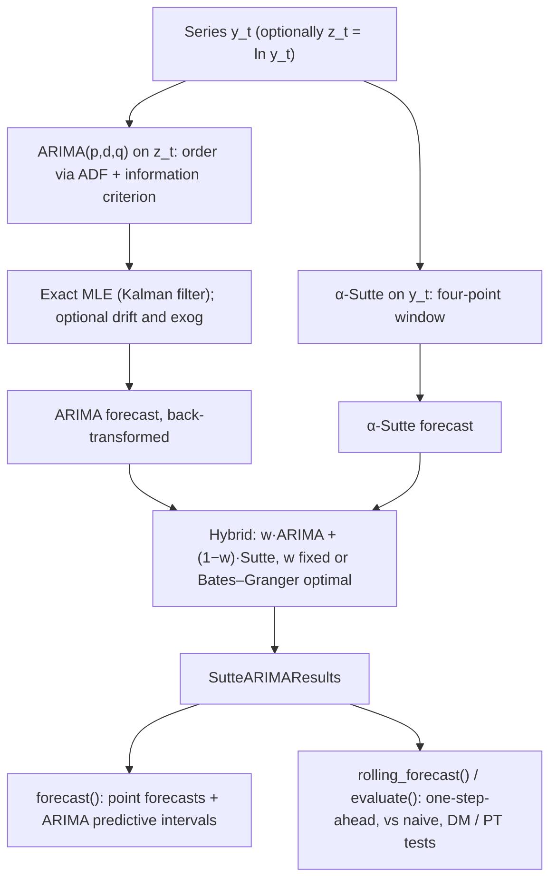

# SutteARIMA: Hybrid α-Sutte + ARIMA Forecasting for Econometrics

[](https://www.python.org/downloads/)
[](https://opensource.org/licenses/MIT)
[](CHANGELOG.md)

**SutteARIMA** combines the non-parametric **α-Sutte indicator** (Ahmar, 2017) with the parametric **Box-Jenkins ARIMA/SARIMAX** model (Ahmar et al., 2019) behind a **statsmodels-style API**: automatic order selection, residual diagnostics, multi-step forecasts with prediction intervals and, since version 2.0, leakage-free out-of-sample evaluation against the naive benchmark.

---

## Table of Contents

1. [Mathematical foundations](#1-mathematical-foundations)
2. [Statistical properties of α-Sutte (read before using it)](#2-statistical-properties-of-α-sutte)
3. [Evaluation methodology](#3-evaluation-methodology)
4. [API reference](#4-api-reference)
5. [End-to-end workflow](#5-end-to-end-workflow)
6. [References](#6-references)

---

# 1. Mathematical foundations



### 1.1 The α-Sutte indicator

For the four most recent observations $`y_{t-4},\dots,y_{t-1}`$:

$$\Delta x = y_{t-3}-y_{t-4},\quad \Delta y = y_{t-2}-y_{t-3},\quad \Delta z = y_{t-1}-y_{t-2}$$

$$m_x = \frac{y_{t-3}+y_{t-4}}{2},\quad m_y = \frac{y_{t-2}+y_{t-3}}{2},\quad m_z = \frac{y_{t-1}+y_{t-2}}{2}$$

$$\tau_x = y_{t-3}\frac{\Delta x}{m_x},\quad \tau_y = y_{t-2}\frac{\Delta y}{m_y},\quad \tau_z = y_{t-1}\frac{\Delta z}{m_z},\qquad \delta_t = \frac{\tau_x+\tau_y+\tau_z}{3}$$

$$\hat{y}_{t}^{\text{Sutte}} = y_{t-1} + \delta_t$$

**Compact notation.** Index the three sub-intervals by their distance to the forecast origin, from $`j = 1`$ (newest, the $`z`$ interval) to $`j = 3`$ (oldest, the $`x`$ interval):

```math
\Delta_j = y_{t-j}-y_{t-j-1},\qquad m_j = \frac{y_{t-j}+y_{t-j-1}}{2},\qquad
\tau_j = y_{t-j}\,\frac{\Delta_j}{m_j} = \frac{2\,y_{t-j}\,(y_{t-j}-y_{t-j-1})}{y_{t-j}+y_{t-j-1}},\qquad
\delta_t = \frac13\sum_{j=1}^{3}\tau_j .
```

**Interpretation of the terms.**
* $`\Delta_j/m_j`$ is the *arc* (mid-point) percentage change of sub-interval $`j`$. It treats both end points symmetrically and, for a positive series, is bounded: $`\lvert\Delta_j/m_j\rvert < 2`$.
* Multiplying by the end-point level $`y_{t-j}`$ converts the relative change back into units of $`y`$. Because $`y_{t-j}/m_j > 0`$, $`\tau_j`$ always has the sign of $`\Delta_j`$; rises are slightly amplified and falls slightly damped (§2.1).
* $`\delta_t`$, the equally weighted average of the three increments, is an estimate of the local slope of the series over the last three periods; the forecast extends the last observation by this slope.

**Information set.** $`\hat y_t^{\text{Sutte}}`$ depends only on $`(y_{t-4},y_{t-3},y_{t-2},y_{t-1})`$ and no parameter is estimated, so the in-sample values returned by `compute_fitted` (from the fifth observation on) are genuine one-step-ahead predictions.

**Recursive multi-step forecasts.** From the origin $`T`$, with $`\hat y_{T+i} = y_{T+i}`$ for $`i\le 0`$,

```math
\hat y_{T+h} = \hat y_{T+h-1} + \delta\big(\hat y_{T+h-4},\,\hat y_{T+h-3},\,\hat y_{T+h-2},\,\hat y_{T+h-1}\big),\qquad h = 1,2,\dots
```

i.e. forecasts are fed back into the four-point window as if they were observations (the implied long-horizon path is derived in §2.5).

**Invariances.** α-Sutte is *scale-equivariant*: multiplying the series by $`c>0`$ multiplies every $`\tau_j`$, and hence the forecast, by $`c`$. It is *not* translation-equivariant: adding a constant changes the ratios $`y_{t-j}/m_j`$; as the level grows relative to the changes, $`\tau_j\to\Delta_j`$. The indicator is intended for positive series.

**Numerical guard and reference implementation.** A guard replaces $`\tau = \Delta`$ when $`|m| < 10^{-12}`$. The implementation reproduces the reference R implementation `alpha.sutte` of the CRAN package `sutteForecastR` 0.1 (Ahmar, 2017) to machine precision (see `tests/`).

### 1.2 The ARIMA component

$$\Phi_p(B)\,\tilde\Phi_P(B^s)\,(1-B)^d(1-B^s)^D z_t = c_t + \Theta_q(B)\,\tilde\Theta_Q(B^s)\,\varepsilon_t,\qquad \varepsilon_t \sim \text{WN}(0,\sigma^2)$$

with $`z_t = y_t`$ (default) or $`z_t = \ln y_t`$ (`transform="log"`), the backshift operator $`B^kz_t = z_{t-k}`$, the deterministic term $`c_t`$ (see *Trend*) and the lag polynomials

```math
\Phi_p(B) = 1-\sum_{i=1}^{p}\phi_iB^i,\qquad \Theta_q(B) = 1+\sum_{j=1}^{q}\theta_jB^j,\qquad
\tilde\Phi_P(B^s) = 1-\sum_{i=1}^{P}\tilde\phi_iB^{is},\qquad \tilde\Theta_Q(B^s) = 1+\sum_{j=1}^{Q}\tilde\theta_jB^{js}.
```

* **Differencing, stationarity and invertibility.** The differenced series $`w_t = (1-B)^d(1-B^s)^Dz_t`$ is a stationary ARMA process when all roots of $`\Phi_p(\lambda)\tilde\Phi_P(\lambda^s) = 0`$ lie outside the unit circle; the moving-average part is invertible when the same holds for $`\Theta_q(\lambda)\tilde\Theta_Q(\lambda^s) = 0`$.
* **Why logs for prices.** For a series that grows multiplicatively, $`\Delta\ln y_t\approx\Delta y_t/y_{t-1}`$ is a percentage return whose variance does not scale with the level, whereas the variance of $`\Delta y_t`$ does. With `transform="log"` the ARIMA component is a model for returns.

**Estimation: exact maximum likelihood via the Kalman filter.** The model is written in state-space form and the Gaussian log-likelihood is evaluated through the prediction-error decomposition

```math
\ln L = -\frac12\sum_{t=1}^{n}\Big[\ln(2\pi)+\ln F_t+\frac{v_t^2}{F_t}\Big],\qquad
v_t = z_t-\operatorname{E}\big[z_t\mid z_1,\dots,z_{t-1}\big],\qquad F_t = \operatorname{Var}(v_t),
```

which is maximised over all parameters (AR, MA, seasonal, trend and exog coefficients and $`\sigma^2`$). Non-stationary components are initialised diffusely, so the first $`d+Ds`$ one-step predictions carry no information. The one-step predictions $`\operatorname{E}[z_t\mid z_{1:t-1}]`$ are the ARIMA fitted values; running the filter with fixed parameters through new observations gives one-step forecasts that use only past data (§3).

**Forecasts and their error variance.** The $`h`$-step forecast $`\hat z_{T+h\mid T} = \operatorname{E}[z_{T+h}\mid z_{1:T}]`$ is obtained by iterating the model equation with future shocks set to zero. Its error is a finite moving average of the future shocks,

```math
z_{T+h}-\hat z_{T+h\mid T} = \sum_{j=0}^{h-1}\psi_j\,\varepsilon_{T+h-j},\qquad
\sigma_h^2 = \sigma^2\sum_{j=0}^{h-1}\psi_j^2,\qquad
\sum_{j\ge0}\psi_jB^j = \frac{\Theta_q(B)\,\tilde\Theta_Q(B^s)}{\Phi_p(B)\,\tilde\Phi_P(B^s)\,(1-B)^d(1-B^s)^D}.
```

For a random walk, ARIMA(0,1,0), $`\psi_j = 1`$ and $`\sigma_h^2 = h\sigma^2`$; for ARIMA(1,1,0), $`\psi_j = (1-\phi^{j+1})/(1-\phi)`$.

**Trend.** statsmodels writes the trend in levels, $`z_t = \text{trend}_t + u_t`$ with $`u_t`$ integrated, so a constant is not identified when $`d+D>0`$: differencing removes it. `trend="drift"` adds the trend term of power $`d+D`$, which becomes a constant after differencing:

```math
d = 1:\qquad z_t = c\,t+u_t,\quad (1-B)\,u_t\sim\text{ARMA}\qquad\Longrightarrow\qquad \Delta z_t = c+\Delta u_t,\qquad \operatorname{E}[\Delta z_t] = c .
```

With `transform="log"`, $`c`$ is the mean log return per period, and for long horizons the point forecast grows linearly, $`\hat z_{T+h\mid T}\approx z_T + h\,c`$.

**Exogenous regressors (regression with ARIMA errors).**

$$z_t = x_t'\beta + u_t,\qquad u_t \sim \text{ARIMA}(p,d,q)\quad\Longrightarrow\quad \Delta z_t = \Delta x_t'\beta + \text{ARMA error}\ \ (d=1)$$

The regression coefficients and the ARMA parameters are estimated jointly by the likelihood above (the regression enters the observation equation of the state-space model), which is equivalent to generalised least squares with an ARIMA error covariance. Because differencing acts on $`x_t`$ as well as on $`z_t`$, the *shape* of an intervention dummy determines what $`\beta`$ measures.

Consequences for intervention dummies when $`d = 1`$ (Box & Tiao, 1975):

| `exog` column | Effect on $`\Delta z_t`$ | Effect on the level of $`z_t`$ |
|---|---|---|
| pulse $`\mathbb 1\{t=t_0\}`$ | $`+\beta`$ at $`t_0`$, $`-\beta`$ at $`t_0+1`$ | one-period jump that fully reverts |
| step $`\mathbb 1\{t\ge t_0\}`$ | $`+\beta`$ at $`t_0`$ | permanent level shift |
| window $`\mathbb 1\{t_0\le t\le t_1\}`$ | $`+\beta`$ at entry, $`-\beta`$ at exit | shift that **fully reverts when the window ends** |
| ramp $`\sum_{s\le t}\mathbb 1\{t_0\le s\le t_1\}`$ | $`+\beta`$ on every window day | permanent cumulative effect $`\beta L`$ |


**Derivation for the ramp.** If $`x_t = \sum_{s\le t}D_s`$ with $`D_s = \mathbb 1\{t_0\le s\le t_1\}`$, then $`\Delta x_t = D_t`$ and $`\Delta z_t = \beta D_t + \text{ARMA error}`$: $`\beta`$ is the average change of $`z`$ per window day and $`\beta L`$, with $`L = t_1-t_0+1`$, the cumulative effect. With `transform="log"`, $`100\beta`$ is the average daily abnormal return in percent. By the same algebra a window dummy entered directly gives $`\Delta x_t = +1`$ on entry and $`-1`$ on exit, which is why its level effect disappears when the window ends.

To estimate the effect of an event on **returns** (growth rates) during a window with `transform="log"` and `d=1`, pass the cumulative sum of the window dummy.

Forecasting with exogenous regressors requires their future values $`x_{T+1},\dots,x_{T+h}`$; they enter the point forecast through $`x_{T+h}'\hat\beta`$, and their own uncertainty is not part of the prediction interval.

> **Look-ahead rule.** Every regressor must be known when the forecast is made. Never build exog from the contemporaneous value of the series (e.g. a dummy for "today's return exceeds 8%"): the regressor then contains the dependent variable, produces spectacular but meaningless t-statistics and information criteria, and cannot be used for forecasting.

### 1.3 The hybrid

$$\hat{y}_t^{\text{SutteARIMA}} = w\,\hat{y}_t^{\text{ARIMA}} + (1-w)\,\hat{y}_t^{\text{Sutte}},\qquad w\in[0,1]$$

The combination is formed on the original scale. With `transform="log"`, $`\hat y_t^{\text{ARIMA}} = \exp(\hat z_t)`$; since $`\exp`$ is monotone this is the predictive **median** of $`y_t`$ (under Gaussian errors the predictive mean would be $`\exp(\hat z_t+\sigma_h^2/2)`$, a difference of order $`\sigma^2/2`$ for one-step forecasts).

$`w = 0.5`$ is the original SutteARIMA. With `weight="optimal"` the weight minimises the in-sample sum of squared one-step errors of the combination (Bates & Granger, 1969).

**Derivation.** With $`e^A_t = y_t-\hat y^{\text{ARIMA}}_t`$ and $`e^S_t = y_t-\hat y^{\text{Sutte}}_t`$, the combination error is $`e^C_t(w) = w\,e^A_t+(1-w)\,e^S_t = e^S_t + w\,(e^A_t-e^S_t)`$. Setting the derivative of $`S(w) = \sum_t e^C_t(w)^2`$ to zero,

```math
\frac{dS}{dw} = 2\sum_t\big[e^S_t+w\,(e^A_t-e^S_t)\big]\big(e^A_t-e^S_t\big) = 0
\qquad\Longrightarrow\qquad
w^* = \frac{\sum_t e^S_t\,(e^S_t-e^A_t)}{\sum_t (e^A_t-e^S_t)^2},\quad\text{clipped to } [0,1].
```

$`S(w)`$ is a convex parabola, so the clipped value is the minimiser over $`[0,1]`$. In population terms, with zero-mean errors, $`\sigma_A^2 = \operatorname{Var}(e^A_t)`$, $`\sigma_S^2 = \operatorname{Var}(e^S_t)`$ and $`\sigma_{AS} = \operatorname{Cov}(e^A_t,e^S_t)`$,

```math
w^* = \frac{\sigma_S^2-\sigma_{AS}}{\sigma_A^2+\sigma_S^2-2\sigma_{AS}},\qquad
\sigma_C^2(w^*) = \frac{\sigma_A^2\sigma_S^2-\sigma_{AS}^2}{\sigma_A^2+\sigma_S^2-2\sigma_{AS}}\;\le\;\min\big(\sigma_A^2,\sigma_S^2\big).
```

The fixed weight $`w = 0.5`$ is optimal only when $`\sigma_A^2 = \sigma_S^2`$. When `transform="log"`, relative errors $`e_t/y_t`$ are used so that all periods count comparably whatever the price level. The weight is computed from in-sample one-step errors in which the ARIMA parameters were fitted on the same data, which slightly favours the ARIMA component; with `rolling_forecast(refit_every=k)` the optimal weight is re-estimated from the data available at each refit.

**Boundary values.** For $`t < 4`$ (no α-Sutte value) the hybrid equals the ARIMA fit; the first $`d + Ds`$ ARIMA fitted values come from the diffuse initialisation and are reported as `NaN`.

### 1.4 Order selection (`find_order`)

1. **Integration order** from ADF tests on $`z_t`$: $`d=0`$ if the level is stationary at 5%, else $`d=1`$ if the first difference is, else $`d=2`$ (or supply `d=`). The augmented Dickey-Fuller regression is

   ```math
   \Delta z_t = \alpha+\gamma\,z_{t-1}+\sum_{i=1}^{k}\delta_i\,\Delta z_{t-i}+e_t,\qquad H_0:\gamma = 0\ \text{(unit root)}\quad\text{vs.}\quad H_1:\gamma<0,
   ```

   with the number of augmentation lags $`k`$ chosen by AIC; the $`t`$-statistic of $`\hat\gamma`$ is compared with Dickey-Fuller critical values. The same regression is applied to $`\Delta z_t`$ when the level has a unit root.
2. **Grid search** over $`p\le p_{\max}`$, $`q\le q_{\max}`$ with the same `trend` and `exog` as the final model; every candidate is estimated by exact maximum likelihood (§1.2).
3. **Criterion**: AICc (default), AIC, BIC or HQIC from statsmodels, where $`k`$ counts all estimated parameters including $`\sigma^2`$:

$$\text{AIC}=-2\ln\hat L+2k,\qquad \text{AICc}=\text{AIC}+\frac{2k(k+1)}{n-k-1},\qquad \text{BIC}=-2\ln\hat L+k\ln n$$

$$\text{HQIC}=-2\ln\hat L+2k\ln\ln n$$

Here $`\hat L`$ is the maximised likelihood and $`k`$ the number of estimated AR, MA, seasonal, trend and exog coefficients plus $`\sigma^2`$. Each criterion trades goodness of fit, $`-2\ln\hat L`$, against complexity:
* **AIC** estimates the expected Kullback-Leibler discrepancy between the fitted and the true model; it is efficient for prediction but tends to select larger models.
* **AICc** adds a finite-sample correction (Hurvich & Tsai, 1989) that matters when $`n/k`$ is small and vanishes as $`n\to\infty`$.
* **BIC** and **HQIC** penalise extra parameters more heavily and are *consistent*: if the true order is among the candidates, they select it with probability approaching one as $`n\to\infty`$. BIC is usually preferable for long series.

The candidate with the smallest criterion is selected; differences of about 2 or less are not decisive.

### 1.5 Forecasts and prediction intervals

* **Point forecasts**: $`\hat y_{T+h} = w\,\hat y^{\text{ARIMA}}_{T+h} + (1-w)\,\hat y^{\text{Sutte}}_{T+h}`$. With `transform="log"`, $`\hat y^{\text{ARIMA}}_{T+h} = \exp(\hat z_{T+h})`$ is the predictive **median**. The ARIMA part is the conditional expectation $`\hat z_{T+h\mid T}`$ of §1.2 and the α-Sutte part is the recursive forecast of §1.1.
* **Intervals (`interval="arima"`, default)**: quantiles of the predictive distribution of the fitted ARIMA model, back-transformed when `transform="log"`. Under Gaussian innovations

  ```math
  z_{T+h}\mid z_{1:T}\;\sim\;N\big(\hat z_{T+h\mid T},\,\sigma_h^2\big)
  \qquad\Longrightarrow\qquad
  \Big[\hat z_{T+h\mid T}-q_{1-\alpha/2}\,\sigma_h,\ \ \hat z_{T+h\mid T}+q_{1-\alpha/2}\,\sigma_h\Big],
  ```

  where $`q_{1-\alpha/2}`$ is the standard normal quantile (1.96 for 95%) and $`\sigma_h`$ is given in §1.2. With `transform="log"` both bounds are exponentiated; because $`\exp`$ is monotone they are the exact quantiles of the (log-normal, right-skewed) predictive distribution of $`y_{T+h}`$. A prediction interval describes the distribution of the future observation, so it does not depend on which point forecast is reported.
* **`interval="legacy"`**: a heuristic band, kept for reproducibility of earlier results,

  ```math
  \hat y^{\text{SutteARIMA}}_{T+h}\;\pm\;q_{1-\alpha/2}\;s_e\,\frac{\sigma_h}{\sigma_1},
  ```

  where $`s_e`$ is the standard deviation of the in-sample one-step hybrid residuals. It is not derived from a predictive distribution: it is centred on the hybrid and scales the one-step residual dispersion by the ARIMA error growth, so it understates uncertainty at long horizons, where the error of the recursive α-Sutte grows like $`h`$ rather than $`\sqrt h`$ (§2.5).


### 1.6 Residual diagnostics (`summary()`)

| Test | Statistic | $`H_0`$ |
|---|---|---|
| Durbin-Watson | $`\sum(\hat e_t-\hat e_{t-1})^2/\sum\hat e_t^2`$ | no first-order autocorrelation (≈ 2) |
| Ljung-Box | $`n(n+2)\sum_{k=1}^m r_k^2/(n-k)`$ | no autocorrelation |
| ARCH-LM (Engle, 1982) | $`nR^2`$ of $`\hat e_t^2`$ on its lags | no conditional heteroskedasticity |
| Jarque-Bera | $`\frac n6\big(S^2+\frac{(K-3)^2}{4}\big)`$ | normality |
| Break-variance | ratio of residual variances in the last/first thirds | homoskedasticity |

**Definitions.** For residuals $`\hat e_t`$ ($`t = 1,\dots,n`$, demeaned), $`r_k = \sum_{t=k+1}^{n}\hat e_t\hat e_{t-k}\big/\sum_{t=1}^{n}\hat e_t^2`$ is the lag-$`k`$ sample autocorrelation, $`S`$ the sample skewness and $`K`$ the sample kurtosis.
* **Durbin-Watson** $`\approx 2(1-r_1)`$: values near 2 indicate no first-order autocorrelation, values below 2 positive and above 2 negative autocorrelation.
* **Ljung-Box**: $`Q(m) = n(n+2)\sum_{k=1}^{m}r_k^2/(n-k)`$ is approximately $`\chi^2_m`$ under $`H_0`$ (the package uses $`m = \min(10,\,n/3)`$ and reports the $`\chi^2_m`$ p-value).
* **ARCH-LM** (Engle, 1982): auxiliary regression $`\hat e_t^2 = a_0+\sum_{i=1}^{q}a_i\,\hat e_{t-i}^2+u_t`$; under $`H_0: a_1=\dots=a_q=0`$ (no volatility clustering) $`LM = n_aR^2\sim\chi^2_q`$, where $`n_a`$ is the number of observations in the auxiliary regression and $`q = \min(10,\,n/10)`$.
* **Jarque-Bera**: $`JB = \frac n6\big(S^2+\frac{(K-3)^2}{4}\big)\sim\chi^2_2`$ under normality ($`S = 0`$, $`K = 3`$).
* **Break-variance**: $`H = \sum_{t=n-h+1}^{n}\hat v_t^2\big/\sum_{t=1}^{h}\hat v_t^2`$ with $`h\approx n/3`$, computed on the standardised one-step ARIMA forecast errors $`\hat v_t`$ and compared with an $`F(h,h)`$ distribution (two-sided).


Hybrid residuals are tested on the modelling scale ($`\ln y_t - \ln\hat y_t`$ when `transform="log"`).

The hybrid is not a likelihood-based model, so its residuals need not be white noise even when the ARIMA component is adequate (§2.2).

### 1.7 Forecast comparison statistics

**Theil's U2.** $`U_2 = \text{RMSE}_{\text{model}}/\text{RMSE}_{\text{benchmark}}`$. With the naive benchmark $`\hat y_t = y_{t-1}`$, $`U_2 < 1`$ means that the model beats the random-walk forecast.

**Diebold-Mariano test.** For the forecast errors $`e_{1t}`$ and $`e_{2t}`$ of two models and the loss $`L(e) = \lvert e\rvert^p`$ ($`p = 2`$: squared, $`p = 1`$: absolute), the loss differential is $`d_t = L(e_{1t})-L(e_{2t})`$, $`t = 1,\dots,T`$. Under $`H_0:\operatorname{E}[d_t] = 0`$ (equal accuracy) and covariance stationarity of $`d_t`$,

```math
DM = \frac{\bar d}{\sqrt{\widehat{\mathrm{LRV}}/T}},\qquad
\widehat{\mathrm{LRV}} = \hat\gamma_0+2\sum_{k=1}^{h-1}\hat\gamma_k,\qquad
\hat\gamma_k = \frac1T\sum_{t=k+1}^{T}\big(d_t-\bar d\big)\big(d_{t-k}-\bar d\big),
```

which is asymptotically $`N(0,1)`$; for one-step forecasts ($`h = 1`$) the long-run variance reduces to $`\hat\gamma_0`$. The Harvey-Leybourne-Newbold correction multiplies the statistic by $`\sqrt{(T+1-2h+h(h-1)/T)/T}`$ and uses Student-$`t_{T-1}`$ critical values. A negative statistic means that model 1 has the smaller expected loss.

**Pesaran-Timmermann test.** Let $`a_t = \mathbb 1\{\Delta y_t > 0\}`$ and $`f_t = \mathbb 1\{\widehat{\Delta y}_t > 0\}`$ be the realised and predicted directions (periods with $`\Delta y_t = 0`$ are dropped), $`\hat P = T^{-1}\sum_t\mathbb 1\{a_t = f_t\}`$ the hit rate, $`p_y = \bar a`$ and $`p_x = \bar f`$. If predicted and realised directions are independent, the expected hit rate is $`P^* = p_yp_x+(1-p_y)(1-p_x)`$, and

```math
PT = \frac{\hat P-P^*}{\sqrt{\widehat{\operatorname{Var}}(\hat P)-\widehat{\operatorname{Var}}(P^*)}}\;\xrightarrow{d}\;N(0,1),\qquad
\widehat{\operatorname{Var}}(\hat P) = \frac{P^*(1-P^*)}{T},
```

```math
\widehat{\operatorname{Var}}(P^*) = \frac{(2p_y-1)^2\,p_x(1-p_x)+(2p_x-1)^2\,p_y(1-p_y)}{T}+\frac{4\,p_yp_x(1-p_y)(1-p_x)}{T^2}.
```

The package reports the one-sided p-value ($`H_1`$: directional skill). The statistic is undefined when all predicted directions are equal ($`p_x\in\{0,1\}`$).

---

# 2. Statistical properties of α-Sutte

The results below explain how α-Sutte behaves and when it can add information to an ARIMA forecast. They hold for a positive series; statements marked "≈" neglect terms of higher order in the relative changes.

### 2.1 Exact decomposition: momentum plus a convexity term

Let $`g_j = \Delta_j/y_{t-j}`$ be the relative change of sub-interval $`j`$ measured at its newer end point. Since $`m_j = y_{t-j}-\Delta_j/2 = y_{t-j}(1-g_j/2)`$, we have $`y_{t-j}/m_j = 1/(1-g_j/2)`$ and, exactly,

```math
\tau_j = \frac{\Delta_j}{1-g_j/2} = \Delta_j+\frac{y_{t-j}\,g_j^2}{2-g_j},
\qquad
\delta_t = \underbrace{\frac13\sum_{j=1}^{3}\Delta_j}_{\text{average of the last three changes}}\;+\;\underbrace{\frac13\sum_{j=1}^{3}\frac{y_{t-j}\,g_j^2}{2-g_j}}_{b_t\;\ge\;0}.
```

For a positive series $`g_j = 1-y_{t-j-1}/y_{t-j} < 1`$, so $`2-g_j > 1`$ and $`b_t\ge 0`$. α-Sutte is therefore a short-run **momentum extrapolation** (the average of the last three changes) plus an **upward convexity bias** $`b_t`$. For small changes $`b_t\approx\tfrac16\sum_j y_{t-j}\,g_j^2`$; if the relative changes have variance $`\sigma_g^2`$, the expected bias is $`\approx y\,\sigma_g^2/2`$ per period, i.e. $`\sigma_g^2/2`$ in relative terms (about 0.08% per period for a 4% volatility).

### 2.2 One-step error when the series is a random walk

Assume $`\Delta y_t = \varepsilon_t`$, independent with mean zero and variance $`\sigma^2`$, and changes small relative to the level, so that $`b_t`$ can be neglected. Then

```math
e^S_t = y_t-\hat y^{\text{Sutte}}_t \approx \varepsilon_t-\tfrac13\big(\varepsilon_{t-1}+\varepsilon_{t-2}+\varepsilon_{t-3}\big),\qquad
\operatorname{Var}(e^S_t) = \sigma^2+3\cdot\tfrac19\,\sigma^2 = \tfrac43\,\sigma^2,
```

whereas the naive forecast $`\hat y_t = y_{t-1}`$ has error $`\varepsilon_t`$ and variance $`\sigma^2`$. Hence

```math
\frac{\text{RMSE}_{\text{Sutte}}}{\text{RMSE}_{\text{naive}}}\approx\sqrt{4/3} = 1.155 .
```

The α-Sutte error is an MA(3) process with coefficients $`(c_0,c_1,c_2,c_3) = (1,-\tfrac13,-\tfrac13,-\tfrac13)`$ and autocovariances $`\gamma_k = \sigma^2\sum_i c_i\,c_{i+k}`$, so its autocorrelations are

```math
\rho_1 = -\tfrac1{12},\qquad \rho_2 = -\tfrac16,\qquad \rho_3 = -\tfrac14,\qquad \rho_k = 0\quad(k>3):
```

α-Sutte residuals are negatively autocorrelated, and a Ljung-Box test on hybrid residuals can reject even when the ARIMA component is adequate.

### 2.3 The equal-weight hybrid

If the ARIMA component behaves like the naive forecast (error $`\varepsilon_t`$), the hybrid error is $`e^H_t = w\,\varepsilon_t+(1-w)\,e^S_t = \varepsilon_t-(1-w)\,\delta_t`$ and

```math
\operatorname{Var}(e^H_t) = \sigma^2\Big(1+\frac{(1-w)^2}{3}\Big);\qquad
w = \tfrac12:\quad \sigma^2\big(1+\tfrac1{12}\big),\qquad \text{RMSE ratio}\approx\sqrt{13/12} = 1.041 .
```

In this case any weight on α-Sutte increases the error, quadratically in $`1-w`$.

### 2.4 Optimal weight and forecast encompassing

Suppose the ARIMA forecast is the conditional mean, $`\hat y^{\text{ARIMA}}_t = \operatorname{E}[y_t\mid\mathcal F_{t-1}]`$. Then $`e^A_t = \varepsilon_t`$ is uncorrelated with everything known at $`t-1`$, while $`e^S_t = \varepsilon_t+\big(\hat y^{\text{ARIMA}}_t-\hat y^{\text{Sutte}}_t\big)`$, where the bracket is known at $`t-1`$. Hence $`\sigma_{AS} = \sigma_A^2`$ and, with the formula of §1.3,

```math
w^* = \frac{\sigma_S^2-\sigma_{AS}}{\sigma_A^2+\sigma_S^2-2\sigma_{AS}} = \frac{\sigma_S^2-\sigma_A^2}{\sigma_S^2-\sigma_A^2} = 1 .
```

A correctly specified ARIMA component **encompasses** α-Sutte, which then receives zero weight. Under the random walk of §2.2, $`\sigma_A^2 = \sigma^2`$, $`\sigma_S^2 = \tfrac43\sigma^2`$, $`\sigma_{AS} = \sigma^2`$ and $`w^* = (4/3-1)/(1+4/3-2) = 1`$. α-Sutte can receive a positive weight only when the ARIMA component misses predictable structure that the last three changes capture, so an estimated $`w^*`$ close to 1 is evidence that α-Sutte adds no information.

### 2.5 Recursive multi-step forecasts

Neglecting the convexity term, the forecast increments $`d_k = \hat y_{T+k}-\hat y_{T+k-1}`$ satisfy

```math
d_k = \tfrac13\big(d_{k-1}+d_{k-2}+d_{k-3}\big),\qquad d_0 = \Delta y_T,\quad d_{-1} = \Delta y_{T-1},\quad d_{-2} = \Delta y_{T-2}.
```

The characteristic polynomial factorises as $`3\lambda^3-\lambda^2-\lambda-1 = (\lambda-1)(3\lambda^2+2\lambda+1)`$; the two complex roots have modulus $`1/\sqrt3\approx 0.58`$, so the transient dies out geometrically, and $`I_k = 3d_k+2d_{k-1}+d_{k-2}`$ is invariant ($`I_{k+1} = I_k`$). Therefore

```math
d_k\;\longrightarrow\;d^* = \frac{3\,\Delta y_T+2\,\Delta y_{T-1}+\Delta y_{T-2}}{6},\qquad
\hat y_{T+h}\approx y_T+h\,d^*\quad(h\ \text{large}):
```

the recursive α-Sutte forecast is a **linear trend** whose slope is a 3:2:1 weighted average of the last three changes. Under the random walk, $`\operatorname{Var}(d^*) = \sigma^2(9+4+1)/36 = \tfrac{7}{18}\sigma^2`$ and, because the future shocks are independent of $`d^*`$,

```math
\operatorname{Var}\big(y_{T+h}-\hat y_{T+h}\big)\approx h\,\sigma^2+\tfrac{7}{18}\,h^2\sigma^2
\qquad\text{versus}\qquad h\,\sigma^2\ \ \text{for the naive forecast}.
```

The RMSE ratio therefore grows like $`\sqrt{1+7h/18}`$: about 1.7 at $`h = 5`$, 3.0 at $`h = 21`$ and 5.0 at $`h = 63`$. The error grows like $`h`$ rather than $`\sqrt h`$, which is why the ARIMA-based interval of §1.5 does not describe the dispersion of the α-Sutte component.

### 2.6 When α-Sutte tracks a series well

* **Linear trend**, $`y_t = a+bt`$: $`\Delta_j = b`$ and, for a level large relative to $`b`$, $`\tau_j\approx b`$, so α-Sutte extrapolates the trend almost exactly (the one-step error is essentially the convexity term).
* **Steady geometric growth**, $`y_t = y_0(1+g)^t`$: $`\Delta_j/m_j = 2g/(2+g)`$ is constant and $`\delta_t = \frac{2g}{2+g}\cdot\frac13\sum_{j=1}^{3}y_{t-j}`$, close to the exact increment $`g\,y_{t-1}`$ for small $`g`$.
* **Smooth series with persistent, positively autocorrelated changes**: the average of the last changes carries information and α-Sutte can improve on the naive forecast.
* **Noisy series close to a random walk**, typical for asset prices: α-Sutte extrapolates noise, with the consequences derived in §2.2–2.5.

### 2.7 Summary for a random walk


| Property | Result |
|---|---|
| One-step error | $`e_t \approx \varepsilon_t - \tfrac13(\varepsilon_{t-1}+\varepsilon_{t-2}+\varepsilon_{t-3})`$, $`\operatorname{Var} = \tfrac43\sigma^2`$, so $`\text{RMSE}_{\text{Sutte}}/\text{RMSE}_{\text{naive}} \approx \sqrt{4/3} = 1.155`$ |
| Equal-weight hybrid with a random-walk-like ARIMA | error variance $`(1+\tfrac1{12})\sigma^2`$, ratio ≈ 1.04 |
| Optimal combination weight | $`w^* = \dfrac{\sigma_S^2-\sigma_{AS}}{\sigma_A^2+\sigma_S^2-2\sigma_{AS}} = \dfrac{4/3-1}{1+4/3-2} = 1`$: α-Sutte gets **zero** weight |
| Recursive $`h`$-step forecast | increments converge to $`(3\Delta y_T+2\Delta y_{T-1}+\Delta y_{T-2})/6`$, i.e. a linear trend; error variance ≈ $`h\sigma^2 + 0.39\,h^2\sigma^2`$ versus $`h\sigma^2`$ for the naive forecast |

α-Sutte can only add value when changes are positively autocorrelated. **Always compare against the naive forecast** with `evaluate()`; level-scale MAPE values of 1–2% for daily prices mainly reflect persistence, not forecasting skill.

**A note on the literature.** The reference function `sutteForecastR::alpha.sutte` reports α-Sutte "test" forecasts that are one-step-ahead predictions using the realised test observations, while the competing models (auto.arima, Holt-Winters, NNETAR, robust ETS, theta) are evaluated with 1- to 7-step static forecasts from the end of the training sample. Comparisons made this way favour α-Sutte mechanically. `rolling_forecast()` evaluates all components under the same one-step-ahead information set.

---

# 3. Evaluation methodology

* **`rolling_forecast(test, exog=None, refit_every=None)`**: expanding-window one-step-ahead forecasts. The forecast of observation $`t`$ uses only data up to $`t-1`$ (plus the period-$`t`$ value of `exog`, which must be known in advance). With `refit_every=k` the ARIMA (and an `"optimal"` weight) is re-estimated every $`k`$ observations; between refits the Kalman filter is run with fixed parameters.
* **`evaluate(...)`**: metrics for the hybrid, its two components and the naive forecast $`\hat y_t = y_{t-1}`$, plus
  * **Theil's U2** $`=\text{RMSE}/\text{RMSE}_{\text{naive}}`$ (< 1 beats the naive forecast);
  * **Diebold-Mariano** test with the Harvey-Leybourne-Newbold correction (squared and absolute loss) against the naive forecast;
  * **Pesaran-Timmermann** test of directional accuracy.
* **`metrics(test)`**: static multi-step accuracy from the end of the sample (U2 against the naive multi-step forecast).

| Metric | Formula | Note |
|---|---|---|
| MAPE (%) | $`\frac{100}{n}\sum\lvert(y_t-\hat y_t)/y_t\rvert`$ | |
| sMAPE (%) | $`\frac{100}{n}\sum\frac{2\lvert y_t-\hat y_t\rvert}{\lvert y_t\rvert+\lvert\hat y_t\rvert}`$ | |
| RMSE, MSE, MAE, MaxAE, MBE | standard | MBE = mean(actual − predicted) |
| TIC (Theil U1) | $`\frac{\text{RMSE}}{\sqrt{\overline{y^2}}+\sqrt{\overline{\hat y^2}}}`$ | close to 0 for any level forecast of a persistent series — not a skill measure |
| U2 | $`\text{RMSE}/\text{RMSE}_{\text{benchmark}}`$ | returned when `benchmark=` is given |
| MASE | $`\text{MAE}/\overline{\lvert\Delta y\rvert}_{\text{train}}`$ | < 1 means better than the *in-sample* naive MAE, not necessarily better than the naive forecast out of sample |

---

# 4. API reference

```python
from sutte_arima import (SutteARIMA, SutteARIMAResults, AlphaSutte, find_order, calculate_metrics,
                         diebold_mariano, pesaran_timmermann, theil_u2)
```

**`SutteARIMA(endog, order="auto", seasonal_order=None, *, exog=None, trend=None, transform=None, weight=0.5)`** → `.fit(**fit_kwargs)` returns `SutteARIMAResults`.

**`SutteARIMAResults`**
* Estimates: `.params`, `.bse`, `.pvalues`, `.params_table()`, `.weight`, `.arima_fittedvalues`, `.sutte_fittedvalues`, `.fittedvalues`, `.resid`, `.resid_model`
* Criteria: `.aic`, `.aicc`, `.bic`, `.hqic`, `.llf`
* Diagnostics: `.durbin_watson`, `.ljung_box`, `.arch_lm`, `.jarque_bera`, `.heteroskedasticity`
* In-sample accuracy: `.mape`, `.rmse`, `.mae`, `.u2`, `.tic`, `.mase`, ..., `.metrics()`, `.metrics_table()`
* Forecasting: `.forecast(steps, alpha=0.05, exog=None, interval="arima")` → columns `SutteARIMA`, `ARIMA`, `AlphaSutte`, `Naive`, `Lower_95`, `Upper_95`
* Out of sample: `.rolling_forecast(test, exog=None, refit_every=None)` → `Actual`, `SutteARIMA`, `ARIMA`, `AlphaSutte`, `Naive`; `.evaluate(test, exog=None, refit_every=None)`
* Reporting: `.summary()`, `.plot(steps=None, alpha=0.05, exog=None)`

**Functions**
* `find_order(data, max_p=3, max_q=3, ic="AICc", verbose=False, *, d=None, transform=None, trend=None, exog=None)`
* `calculate_metrics(actual, predicted, train_data=None, benchmark=None)`
* `diebold_mariano(errors_1, errors_2, h=1, power=2, harvey_correction=True)` → `statistic`, `p_value`, `mean_loss_differential`, `n` (negative statistic: model 1 more accurate)
* `pesaran_timmermann(actual_change, predicted_change)` → `hit_rate`, `statistic`, `p_value` (one-sided)
* `theil_u2(actual, predicted, benchmark)`
* `AlphaSutte.step_increment(...)`, `AlphaSutte.compute_fitted(series)`, `AlphaSutte.compute_forecast(series, steps)`

### Installation

```bash
pip install --upgrade git+https://github.com/BahmanOrujov/sutte-ARIMA.git
```

Dependencies: `numpy`, `pandas`, `scipy`, `statsmodels` (`matplotlib` optional for plotting, `pytest` for the tests).

---

# 5. End-to-end workflow

```python
import numpy as np
from sutte_arima import SutteARIMA, find_order

prices = ...                       # positive price series
train, test = prices[:-250], prices[-250:]

# 1. Order on the log scale with drift (BIC is consistent for long daily series)
order = find_order(train, ic="BIC", transform="log", trend="drift", verbose=True)

# 2. Fit the hybrid (original equal weight) and the data-driven weight
res = SutteARIMA(train, order=order, transform="log", trend="drift").fit()
res_opt = SutteARIMA(train, order=order, transform="log", trend="drift", weight="optimal").fit()
print(res.summary())
print("optimal weight on ARIMA:", res_opt.weight)

# 3. Leakage-free one-step-ahead evaluation against the naive forecast, monthly re-estimation
print(res.evaluate(test, refit_every=21))

# 4. Multi-step forecasts with ARIMA predictive intervals
print(res.forecast(steps=10))

# 5. Exogenous regressors known in advance, e.g. yesterday's limit-up dummy.
#    With d = 1 and transform="log", a growth-rate effect needs the cumulative sum:
limit_up_yesterday = ...           # 0/1 array aligned with prices, built from t-1 information only
X = np.cumsum(limit_up_yesterday).reshape(-1, 1)
resx = SutteARIMA(train, order=order, transform="log", trend="drift", exog=X[:-250]).fit()
print(resx.evaluate(test, exog=X[-250:], refit_every=21))
```

Run the tests with `python -m pytest tests`.

---

# 6. References

1. Ahmar, A. S. (2017). *sutteForecastR: Forecasting Data using Alpha-Sutte Indicator* (R package 0.1). CRAN.
2. Ahmar, A. S., Rahman, A., & Mulbar, U. (2018). α-Sutte Indicator: a new method for time series forecasting. *Journal of Physics: Conference Series*, 1040, 012018.
3. Ahmar, A. S., et al. (2019). SutteARIMA: Short-term forecasting method. *Journal of Physics: Conference Series*, 1364, 012028.
4. Bates, J. M., & Granger, C. W. J. (1969). The combination of forecasts. *Operational Research Quarterly*, 20(4), 451–468.
5. Box, G. E. P., & Tiao, G. C. (1975). Intervention analysis with applications to economic and environmental problems. *Journal of the American Statistical Association*, 70(349), 70–79.
6. Box, G. E. P., Jenkins, G. M., Reinsel, G. C., & Ljung, G. M. (2015). *Time Series Analysis: Forecasting and Control* (5th ed.). Wiley.
7. Diebold, F. X., & Mariano, R. S. (1995). Comparing predictive accuracy. *Journal of Business & Economic Statistics*, 13(3), 253–263.
8. Engle, R. F. (1982). Autoregressive conditional heteroscedasticity with estimates of the variance of United Kingdom inflation. *Econometrica*, 50(4), 987–1007.
9. Harvey, D., Leybourne, S., & Newbold, P. (1997). Testing the equality of prediction mean squared errors. *International Journal of Forecasting*, 13(2), 281–291.
10. Hurvich, C. M., & Tsai, C.-L. (1989). Regression and time series model selection in small samples. *Biometrika*, 76(2), 297–307.
11. Hyndman, R. J., & Koehler, A. B. (2006). Another look at measures of forecast accuracy. *International Journal of Forecasting*, 22(4), 679–688.
12. Pesaran, M. H., & Timmermann, A. (1992). A simple nonparametric test of predictive performance. *Journal of Business & Economic Statistics*, 10(4), 461–465.
